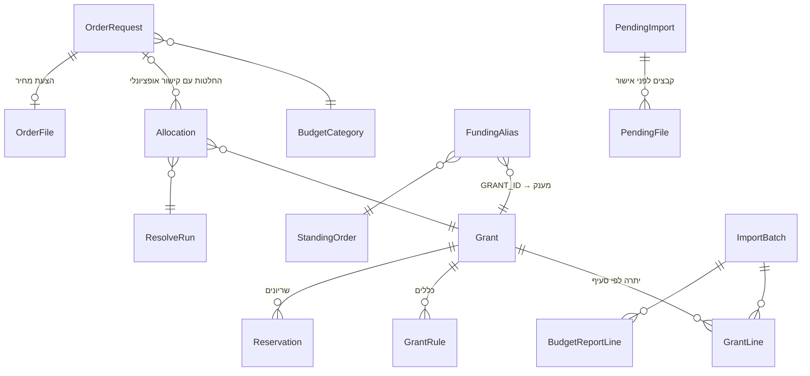

<div dir="rtl">

# GrantWise / LabFund

[כניסה למערכת](https://grantwise-production-730e.up.railway.app/)

**כלי עזר להחלטות מימון במעבדת מחקר: מענקים, רכש ומשאבים**

`גרסה 0.8.0` · Python 3.13 · Django 5.2 · PostgreSQL / SQLite · PuLP (CBC) · אוקטובר 2026

GrantWise הוא שם המאגר; בפרויקט Django ובחלק מהתיעוד נשמר השם LabFund. המערכת מיועדת למנהל/ת המעבדה ולחוקר/ת הראשי/ת, שצריכים לבחור מקור מימון לבקשות ולראות מה יישאר בכל מענק לאחר ההחלטה.

המסמך מתאר את גרסה 0.8.0, שכוללת את הפיתוחים שאחרי 0.7.0: שני דפי בקשות, הצעות מחיר עם סכומים לפני ואחרי מע״מ, מע״מ לפי מענק, ועזרה ב-AI לניסוח הוראות לחישוב. פירוט השינויים נמצא ב-[CHANGELOG.md](CHANGELOG.md). צילומי המסך נשמרו מהתיעוד המקורי של 12/10/2026; חלק משמות המסכים והעמודות בהם קודמים לממשק הנוכחי.


---

## תוכן עניינים

1. [הבעיה](#הבעיה)
2. [הפתרון](#הפתרון)
3. [מה LabFund לא עושה](#מה-labfund-לא-עושה)
4. [צורת העבודה](#צורת-העבודה)
5. [הדשבורדים](#הדשבורדים)
6. [המלצות: איך נבחרת ההמלצה](#המלצות-איך-נבחרת-ההמלצה)
7. [הצעות מחיר, סכומים ומע״מ](#הצעות-מחיר-סכומים-ומעמ)
8. [עזרה ב-AI](#עזרה-ב-ai)
9. [המודל המתמטי של ההמלצות](#המודל-המתמטי-של-ההמלצות)
10. [שערי חליפין](#שערי-חליפין)
11. [מודל הנתונים](#מודל-הנתונים)
12. [מבנה הקוד](#מבנה-הקוד)
13. [פיתוח ושינויים במערכת](#פיתוח-ושינויים-במערכת)
14. [התקנה והרצה](#התקנה-והרצה)
15. [פריסה ל-Railway](#פריסה-ל-railway)
16. [בדיקות](#בדיקות)
17. [ממצאים מהנתונים האמיתיים](#ממצאים-מהנתונים-האמיתיים)
18. [מגבלות וצעדים הבאים](#מגבלות-וצעדים-הבאים)
19. [היסטוריית גרסאות](#היסטוריית-גרסאות)

---

## הבעיה

במעבדה כ-15 אנשים, כמה מענקים במקביל ממקורות שונים, ובכל אחד מטבע אחר (₪, דולר, יורו), תאריך סיום אחר וכללים משלו: מה מותר לקנות ומאיזה סעיף. המידע מפוזר בין שתי מערכות שלא מדברות זו עם זו:

| מערכת | מה יש בה | מה חסר |
|---|---|---|
| **LabSuit** | בקשות רכש (מי ביקש, מה, מתי, סטטוס) ותווית GRANT_ID | אין API. למרבית ההזמנות אין מחיר, והסטטוסים לא תמיד מתעדכנים |
| **SAP / TRDF** | יתרות מענקים לפי סעיף | אין API. התמונה מתעדכנת רק כשמייצאים דוח, ולא רואים בה בקשות שעוד לא הפכו להזמנת רכש |

לכן כל בקשה שאושרה מעלה את אותה שאלה: **מאיזה מענק לשלם?** התשובה תלויה בכמה דברים בבת אחת:

- מה היתרה בסעיף המתאים, ומה כבר "תפוס" על ידי החלטות שעוד לא הגיעו ל-SAP.
- איזה מענק עומד להסתיים ועלול להחזיר כסף.
- מה מוקצה מראש: משכורות, ומענקי רזרבה שעדיף לא לגעת בהם.
- המרת מטבע בין מחיר ההזמנה למטבע המענק.
- האם מענק אחד יכול לכסות את הבקשה במלואה, בהתאם לעבודה עם GRANT_ID יחיד ב-LabSuit.
- האם הסכום כולל מע״מ, והאם המענק הנבחר משלם אותו.

היום עושים את זה בגיליונות ובזיכרון. קשה לראות את התמונה המלאה, קל לפספס מענק שמסתיים, ואין תיעוד למה הוחלט מה שהוחלט.

## הפתרון

LabFund מחבר בין שתי המערכות **דרך ייבוא קבצים**, ומוסיף מעליהן שכבת החלטה:

1. **ייבוא** של ייצוא ההזמנות מ-LabSuit ושל יתרות המענקים מ-SAP (`.xlsx`, `.xls`, `.txt`), ב-Merge או ב-Replace, עם היסטוריה של כל ייבוא. את ייצוא ההזמנות LabFund יכול גם להוריד בעצמו (**עדכון אוטומטי**).
2. **דשבורדים שנערכים במקום.** כל טבלה היא גם המסך וגם העורך: לוחצים על תא, משנים, והשינוי נשמר. אין מסכי ניהול נפרדים.
3. **המלצות.** מסך שמחשב המלצה לבקשות הפתוחות משני דפי הבקשות. בחישוב נכללות הבקשות שנבחרו ועומדות בתנאי הסכום, התאריך והסטטוס. כמו בפועל, שבו מממנים בקשה על ידי רישום GRANT_ID אחד, כל בקשה ממומנת ממענק אחד. ההמלצה מגיעה מאופטימיזציה בשלמים על הבקשות שנבחרו ביחד, ובכל שורה אפשר לבחור מענק אחר.
4. **אישור ההחלטה משפיע על כל הדשבורדים.** הסכום שאושר מופיע כ"ממתין" ויורד מהזמין, עד שדוח SAP חדש מכסה את ההזמנה.
5. **תצוגה מקדימה לכל ייבוא.** לפני שקובץ נקלט, רואים מה ישתנה בדיוק, ושום דבר לא נשמר בלי אישור.
6. **שערי חליפין אוטומטיים** מבנק ישראל, עם גיבוי ממקור שני, בלי עדכון ידני.
7. **הצעות מחיר ומע״מ.** שמירת PDF ליד הבקשה, חילוץ מקומי של הסכומים והמטבע, ותמחור חומר לפי סכום כולל או לפני מע״מ בהתאם למענק.
8. **עזרה ב-AI.** הוראה בעברית, כגון "שמור 10,000 ש״ח במענק 2035816", מתורגמת להוראות שהמנוע יכול לבדוק ולהפעיל. החישוב והאישור ממשיכים להתבצע בקוד המערכת.

### המערכת המוצעת והמצב הנוכחי

המערכת המוצעת מרכזת במקום אחד את תמונת הבקשות והיתרות, ומאפשרת לעבור מנתונים מיובאים להחלטת מימון מוסברת. המטרה היא לצמצם עבודה ידנית בגיליונות, לנצל מענקים בזמן ולתעד מי אישר כל החלטה ועל אילו סכומים ושערים היא נשענה.

הבסיס כבר ממומש ביישום Django: ייבוא עם תצוגה מקדימה, עריכה במקום, חישוב משותף לבקשות, אישור החלטות ומעקב עד לדוח SAP הבא. הפיתוחים האחרונים מוסיפים מידע מהצעות המחיר ואת הוראות המשתמש לחישוב. שלבי העבודה מפורטים בהמשך; יכולות שעדיין חסרות מרוכזות ב-[מגבלות וצעדים הבאים](#מגבלות-וצעדים-הבאים).

### עקרונות

- **כלי עזר, לא ERP.** מקור האמת נשאר SAP ו-LabSuit. LabFund לא כותב אליהן דבר: אחרי אישור, רושמים ידנית את ה-GRANT_ID ב-LabSuit. העדכון האוטומטי רק **קורא** מ-LabSuit, כלומר מוריד ייצוא.
- **המלצה אינה החלטה.** חישוב ההמלצות לא כותב החלטות מימון. רק "אישור המסומנות" שומר את ההקצאות. קבצים שממתינים לייבוא נשמרים זמנית לצורך התצוגה המקדימה, והוראות AI נשמרות ב-session של המשתמש.
- **נתוני המעבדה לא נדרסים.** שדות שהמעבדה ערכה (פרויקט, סעיף, סכום ידני, הגדרות מענק) נשמרים גם ב-Replace.
- **הכול מוסבר.** כל המלצה מגיעה עם נימוק, וכל בקשה שלא נכנסה לחישוב מופיעה עם הסיבה.

## מה LabFund לא עושה

- לא מתחבר ל-SAP. ל-LabSuit הוא מתחבר רק כדי להוריד ייצוא, ולא כותב אליה.
- לא מנהל תהליך אישור רכש. האישור נשאר ב-LabSuit.
- לא מחליף את הדוחות הרשמיים. היתרות ב-LabFund הן הערכה שמבוססת על הקובץ האחרון ועל ההחלטות שאושרו מאז.

---

## צורת העבודה

```mermaid
flowchart LR
  A[LabSuit<br/>הזמנות] -->|קובץ או עדכון אוטומטי| C[עדכון ממקור אחר]
  B[ייצוא מ-SAP<br/>יתרות מענקים] -->|קובץ| C
  C --> P[תצוגה מקדימה<br/>אישור או ביטול]
  P --> D[דשבורדים<br/>עריכה במקום]
  D --> E[המלצות<br/>המלצה ועריכה]
  E -->|אישור| F[ממתין ל-SAP<br/>בכל הדשבורדים]
  F -->|רישום GRANT_ID ב-LabSuit +<br/>"עודכן במערכות המעבדה"| G[LabSuit / SAP]
  G -->|דוח SAP הבא| H[כלול ביתרת SAP]
```

### 1. כניסה


בהתקנה הראשונה נוצר משתמש **admin** עם סיסמה **admin**. כל עוד נכנסים עם הסיסמה הזו, מוצגת באתר תזכורת לשנות אותה (ראו [משתמש ברירת מחדל](#משתמש-ברירת-מחדל)).

### 2. הגדרה ראשונית (פעם אחת)

1. **עדכון הנתונים:** מענקים (יתרות TRDF) מקובץ, והזמנות מקובץ או בעדכון אוטומטי מ-LabSuit (ראו בהמשך).
2. **בדשבורד המענקים:** בודקים את המטבע, תאריך הסיום והיתרות לפי סעיף, ומגדירים לכל מענק אם הוא משלם מע״מ. שריונים, כללי סעיף ועדיפות שנשמרו בעבר עדיין משפיעים על המנוע, אך כרגע אין מסך לעריכתם.
3. **בדפי הבקשות:** בודקים את הסעיף, הסכום והמטבע. חומרים מופיעים ב"הזמנות חומרים", ושכר, שירותים ושאר הסעיפים ב"אחר". שדה "פרויקט" הוא טקסט לתיעוד בלבד.
4. **בהגדרות:** מטבעות ושערי חליפין, ומשתמשים למנהלים.


> **Merge** מעדכן שורות קיימות ומוסיף חדשות. **Replace** מתייחס לקובץ כאל התמונה המלאה, ושורות שלא מופיעות בו מוסתרות (לא נמחקות). **תאריך הנתונים** הוא התאריך שבו הדוח הופק, ולא תאריך ההעלאה. ממנו המערכת יודעת אילו הזמנות כבר כלולות ביתרת SAP. אם מעלים קובץ ישן יותר מהנתונים הפעילים, המערכת מבקשת אישור.

#### תצוגה מקדימה לפני כל עדכון

אחרי בחירת הקובץ, המערכת קוראת אותו ומחשבת את העדכון, אבל **לא שומרת דבר**. נפתח מסך שמראה מה בדיוק ישתנה:

- **ספירות:** כמה שורות חדשות, כמה ישתנו, כמה יוסתרו, כמה יחזרו לפעילות וכמה ללא שינוי.
- **שורות שישתנו:** לכל שורה, אילו שדות השתנו, מה היה ומה יהיה. בהזמנות מוצג גם סיכום של שינויי הסטטוס, למשל כמה עברו מ-ordered ל-received.
- **נשמר כמו שהוא:** הנתונים שהוגדרו ב-LabFund ולא מגיעים מהקובץ: טקסט הפרויקט, סכומים ידניים, תיקוני הצעת מחיר, הערות, החלטות מימון, הגדרות מענק, שריונים וכללים.
- **החלטות מימון שייכללו ביתרת SAP:** אילו החלטות יפסיקו לרדת מהזמין בעקבות הקובץ.
- **אזהרות:** ערכי GRANT_ID חדשים שהמערכת לא מזהה, עמודות או סיווגים של SAP שלא ממופים לסעיף, והזמנות עם החלטה מאושרת שנעלמו מהקובץ.

משם בוחרים **אישור ועדכון** או **ביטול**. אפשר גם לעבור בין Merge ל-Replace ולראות מיד מה ההבדל, בלי להעלות את הקובץ שוב.


#### עדכון אוטומטי מ-LabSuit

בדשבורד **הזמנות חומרים** הכפתור נקרא **"עדכון ממקור אחר"**, ונפתחות ממנו שתי אפשרויות: **עדכון מקובץ** (כמו קודם, עם Merge או Replace) ו**עדכון אוטומטי**. הייבוא משותף לכל הבקשות; כל בקשה מוצגת אחר כך בדף של הסעיף שלה.


בעדכון האוטומטי נפתח חלון אישור. בפעם הראשונה מזינים בו שם משתמש וסיסמה ל-LabSuit. הם נשמרים פעם אחת, והסיסמה נשמרת מוצפנת ולא מוצגת שוב. בפעמים הבאות מוצג המשתמש השמור, ואפשר ללחוץ "שינוי שם משתמש וסיסמה" לפני האישור.

| בפעם הראשונה | כשיש משתמש שמור |
|---|---|
|  |  |

אחרי האישור מוצג מסך טעינה, ומאחורי הקלעים דפדפן אוטומטי (Playwright, בלי חלון):

1. נכנס לדף ההזמנות ב-LabSuit (`…/dashboard/?labId=3861#orders/status[]=approved`, הרשימה המסוננת של ההזמנות המאושרות).
2. מזין את שם המשתמש בשדה הראשון ואת הסיסמה בשדה השני, ולוחץ **Login**.
3. נכנס **שוב** לדף ההזמנות ומרענן אותו. אחרי ההתחברות LabSuit מעביר לדף הבית שלו, ובלי הרענון דף ההזמנות לא נטען.
4. לוחץ **Export** בצד הדף, ובחלון שקופץ באתר לוחץ שוב **Export**.
5. מחכה עד דקה לקובץ שיורד.
6. מעביר את הקובץ ל**תצוגה המקדימה ב-Merge**. משם ממשיכים כרגיל: אישור ועדכון, או ביטול.

**העדכון האוטומטי הוא תמיד Merge:** שורות חדשות נוספות וקיימות מתעדכנות. בקשות שנעלמו מהייצוא ובקשות ידניות אינן מוסתרות בשל היעדרן מהקובץ, והשדות המקומיים נשמרים. בנפרד, אם הייבוא מזהה ש-GRANT_ID של בקשה שאושרה כאן כבר עודכן למענק שנבחר, הבקשה מסומנת כמעודכנת ומוסרת לפי מחזור החיים המתואר בהמשך.

הכפתורים מזוהים לפי הטקסט שלהם ("Login", "Export") ולא לפי המיקום שלהם על המסך. שינויים בזרימת ההתחברות, בכפתורים או בחלונית הקבצים עלולים לדרוש התאמה של הרובוט. הורדת PDF לכל בקשה יכולה להאריך את הריצה, במיוחד בעדכון הראשון.

| בזמן הטעינה | התוצאה: תצוגה מקדימה ב-Merge |
|---|---|
|  |  |

**אם משהו נכשל**, למשל סיסמה שגויה, כפתור שלא נמצא או קובץ שלא ירד תוך דקה, החלון מציג שהייתה בעיה בהבאת הנתונים האוטומטית וממליץ להביא אותם ידנית, עם כפתור שעובר ישר ל"עדכון מקובץ". ב"פרטים טכניים" יש גם צילום מסך של הרגע שבו התהליך נעצר, כדי שיהיה קל לראות מה השתנה באתר. גם קובץ ריק, או קובץ שאינו מהסוג הנכון (למשל ייצוא של דף אחר ב-LabSuit), נעצר כאן ולא מגיע לתצוגה המקדימה.


הכתובת שהרובוט נכנס אליה מוגדרת ב-`LABSUIT_ORDERS_URL`, וכך גם מספר השניות שהוא מחכה לקובץ (`AUTOFETCH_DOWNLOAD_SECONDS`).

**קובצי PDF.** מיד אחרי הייצוא, באותה כניסה, הרובוט עובר על כל בקשה בקובץ: טוען את כל הרשימה (היא נטענת בגלילה), לוחץ על שם הבקשה, ולוקח את הקובץ היחיד שמופיע תחת Files בחלונית הצד (הצעת המחיר של הספק). הקבצים ממתינים עם התצוגה המקדימה במסד הנתונים. רק באישור הם מצורפים לבקשות ומופיעים בעמודה **"הצעת מחיר"**, ונעשה מהם חילוץ מקומי של סכומים ומטבע. בתצוגה המקדימה מופיע דוח: כמה הורדו, כמה כבר שמורים, ואילו בקשות בלי קובץ או שלא נמצאו. קובץ שמספר ההצעה שלו לא תואם לבקשה לא נשמר, כדי שלא יצורף להזמנה הלא נכונה. בקשה שכבר יש לה קובץ מדולגת, כך שהריצה הראשונה ארוכה והבאות קצרות. ראו [הצעות מחיר, סכומים ומע״מ](#הצעות-מחיר-סכומים-ומעמ).

> **בהרצה על מחשב אישי** צריך להתקין פעם אחת את הדפדפן האוטומטי: `python -m playwright install chromium`. אם הוא חסר, החלון מציג את הפקודה הזו. בשרת Railway הוא כבר מותקן דרך ה-`Dockerfile`.

### 3. השגרה: כשיש בקשות חדשות

1. בדשבורד **הזמנות חומרים**: "עדכון ממקור אחר", ואז **עדכון אוטומטי** (או עדכון מקובץ שייצאתם), ואישור התצוגה המקדימה.
2. בודקים את הבקשות בשני הדפים. בחומרים משלימים או מתקנים את סכומי הצעת המחיר והמטבע; ב"אחר" מזינים את הסכום הרלוונטי. בקשה בלי סכום לא מקבלת המלצה.
3. נכנסים ל**המלצות**, בוחרים את הבקשות שרוצים לכלול, ולוחצים **"חשב מחדש למסומנות"** לאחר שינוי הבחירה. לכל בקשה מחושב מענק אחד, או מוצגת הסיבה שאין לה המלצה.
4. אפשר להוסיף הוראה ב**"העזר ב-AI"**, לבדוק אילו הוראות הופעלו ולהסיר אותן לפי הצורך. אפשר גם לבחור מענק אחר ידנית; "יישאר" והסיכום מתעדכנים מיד.
5. בודקים את ההמלצות ואת סיכום החלוקה, ולוחצים **"אישור המסומנות"**.
6. רושמים ב-LabSuit את ה-GRANT_ID של המענק שנבחר, ולוחצים בהמלצות על **"עודכן במערכות המעבדה"** ליד ההחלטה. גם בלי ללחוץ: בעדכון ההזמנות הבא, LabFund מזהה שה-GRANT_ID ב-LabSuit הוא המענק שהוחלט עליו, ומסמן את ההחלטה בעצמו.


אחרי האישור, הבקשות יוצאות מדפי **הזמנות חומרים / אחר** ועוברות ל**סל המחזור** בתחתית דף ההמלצות. בכל שורה בסל רואים את המענק שאושר, את **נימוק ההמלצה**, את הערך בשקלים בעת האישור (ואם השער או הסכום השתנו מאז, גם את הערך של היום) ומי אישר ומתי.

- **"♻ מחזור"** מבטל את האישור ומחזיר את הבקשה לדף המתאים לסעיף שלה. ההמלצה תחושב מחדש לפי השערים והיתרות של היום, כך שמטבע ששערו השתנה יתומחר מחדש.
- **"עודכן במערכות המעבדה"**: לוחצים עליו אחרי שעדכנתם את LabSuit או את SAP. ההזמנה **נמחקת מהמערכת** (גם קובץ ה-PDF שלה), והסכום שלה **ממשיך לרדת מהמענק** (הוא לא חוזר אליו) עד שדוח SAP מכסה אותו. ההחלטה ופרטי הבקשה הדרושים למעקב נשמרים במסד הנתונים, גם אחרי המחיקה; כרגע אין במענקים מסך פירוט החלטות. אין דרך חזרה: אם LabSuit ישלח את אותה בקשה שוב בעדכון הבא, היא תיכנס כבקשה חדשה. אם LabSuit כבר מציג את ה-GRANT_ID שהוחלט, הסימון והמחיקה נעשים אוטומטית בעדכון ההזמנות.

כל בקשה פתוחה משני דפי הבקשות מופיעה גם בטבלת הבקשות בדף ההמלצות. מי שאין לה המלצה מסומנת בסיבה: חסר סכום, ישנה מדי, כבר כלולה ביתרות SAP, על הזמנה עומדת, או הוצאה מהחישוב בבחירה של המשתמש.

הסכום ממשיך לרדת מהזמין עד שדוח SAP יכסה את ההזמנה (ראו בהמשך). אם ל-LabSuit אין תאריך הזמנה, תאריך הסימון משמש במקומו.

### 4. פעם בשבוע: עדכון SAP

מעלים את דוח היתרות מ-SAP בדשבורד **מענקים**, עם התאריך האמיתי של הדוח. החלטה שהדוח מכסה עוברת אוטומטית ל"כלול ביתרת SAP" ויוצאת מ"ממתין", כך שהסכום לא יורד פעמיים.

SAP מייצא רק יתרות מצטברות, בלי שורות של הזמנות, ולכן "מכסה" היא הסקה לפי תאריכים: הדוח מכסה החלטה אם תאריכו לא מוקדם מהיום שבו ההזמנה יצאה. היום הזה הוא תאריך ההזמנה ב-LabSuit (כשיש מספר הזמנה ותאריך), ואם אין, היום שבו סומן "עודכן במערכות המעבדה". **החלטה בלי תאריך ידוע נשארת שמורה.** זו התאמה שמרנית, אך אינה הוכחה חשבונאית שהוצאה מסוימת נקלטה ב-SAP; היתרה תלויה גם באיכות הקובץ ובתאריך הדוח.

---

## הדשבורדים

בכל הדשבורדים עובדים באותו אופן:

- **עריכה במקום.** לוחצים על תא, משנים, ו-Enter או יציאה מהתא שומרים. תא שנשמר מהבהב בירוק, ותא עם ערך לא תקין נצבע באדום.
- **"עדכון מקובץ"**, או **"עדכון ממקור אחר"** בהזמנות (קובץ או עדכון אוטומטי מ-LabSuit), ו-**"+ הוספת שורה"** בדשבורדים שזה רלוונטי להם.
- **ⓘ.** ההסבר מופיע ב-tooltip כשמרחפים על הסמל, כך שהמסך נשאר נקי:


דפי העבודה הם הזמנות חומרים, אחר, מענקים והמלצות, ולצדם הגדרות.

| דשבורד | מקור הנתונים | הוספת שורה | עיקר התוכן |
|---|---|---|---|
| **הזמנות חומרים** (`/orders/`) | ייצוא הזמנות מ-LabSuit, מקובץ או אוטומטית | ✓ | חומרים ובקשות בלי סעיף; PDF, סה״כ כולל ולפני מע״מ, מטבע ועריכה במקום |
| **אחר** (`/other/`) | בקשות מיובאות בסעיפים אחרים או הזנה ידנית | ✓ | שכר, שירותים ושאר הסעיפים; סכום אחד ללא התאמת מע״מ |
| **מענקים** (`/grants/`) | יתרות TRDF מ-SAP | ✓ | שורה לכל מענק, יתרות לפי הסעיפים בקובץ, ממתין, זמין, ימים לסיום וסימון מע״מ |
| **המלצות** (`/resolve/`) | שני דפי הבקשות והיתרות הפעילות | — | חישוב למסומנות, הוראות AI, בחירת מענק, אישור וסל מחזור |
| **הגדרות** | — | ✓ | שערי חליפין ומשתמשים; ניהול משתמשים למנהלים בלבד |

### מענקים


- **ימים לסיום:** נקודה כתומה כשהמענק מתקרב לסיום ועדיין יש בו יתרה, ונקודה אדומה כשהמענק הסתיים ונשארה בו יתרה.
- **ממתין:** סכום ההחלטות שאושרו ב-LabFund ו-SAP עוד לא רואה.
- **זמין** = יתרת SAP − שריונים − ממתין − הזמנות שיצאו אחרי תאריך הדוח.
- **סעיפי התקציב:** מוצגות הקטגוריות שקיימות בדוח SAP הפעיל. סעיף שלא מופיע באף מענק מוסתר, כדי לצמצם עמודות ריקות.
- **מע״מ:** תיבה הקובעת אם המענק מחויב בסכום חומר כולל מע״מ או לפני מע״מ. ייבוא SAP שומר את הבחירה המקומית.

בממשק הנוכחי כל מענק מוצג בשורה אחת. הפירוט הנפתח, עריכת השריונים והכללים וטבלת ההחלטות הוסרו מהממשק. נתונים שכבר נשמרו עדיין קיימים ומשמשים בחישוב. הצילום הבא מתעד את הפירוט בגרסה הקודמת:


### הזמנות חומרים ואחר


בקשות בסעיף `MATERIAL`, או בלי סעיף, מוצגות ב**הזמנות חומרים**. יתר הסעיפים מוצגים ב**אחר**. שינוי הסעיף מעביר את הבקשה לדף המתאים. בשני הדפים אפשר לחפש, לסנן ולערוך במקום; בחומרים מזינים את שני סכומי הצעת המחיר, ובאחר סכום אחד.

בקשות שאושרו בהמלצות לא מופיעות בדפים האלה: הן ממתינות ב**סל המחזור** בדף ההמלצות, ואחרי "עודכן במערכות המעבדה" הן יוצאות מהמערכת. מי שהחלטת המימון שלה בוטלה ב"♻ מחזור" חוזרת לדף של הסעיף שלה. ערכי GRANT_ID ש-LabSuit שולח מזוהים אוטומטית: מספר מענק, הזמנה עומדת / שמור-מכור (ולכן לא נכנסת להמלצות), או "פתוח".

עמודת **"פרויקט"** היא טקסט חופשי שנשמר גם בייבוא חוזר; ברירת המחדל היא תווית GRANT_ID מ-LabSuit. אפשר לבחור מספר מענק כהצעת טקסט, אך הטקסט אינו קובע את המענק המממן ואינו מגביל את ההמלצה.

**מחיקת בקשה** מוחקת גם בקשה שיובאה מ-LabSuit. אם יש לה החלטה שלא סומנה כמעודכנת, המחיקה משחררת אותה; ייצוא עתידי שמכיל אותה יכניס אותה כבקשה חדשה. פעולה זו שונה מ"עודכן במערכות המעבדה", ששומרת את החלטת המימון עד לכיסוי ב-SAP.

### הגדרות


- **שערי חליפין:** המטבעות שמתעדכנים אוטומטית. הוספת מטבע לפי קוד בן 3 אותיות, היסטוריית שערים ותיקון ידני.
- **משתמשים:** הוספה, הרשאת מנהל, השבתה ושינוי סיסמה. זמין למנהלים בלבד.


> הצילומים צולמו על ייצוא אמיתי מ-12/10/2026. כתובות המייל של המבקשים הוחלפו בכתובות בדויות, ושערי החליפין בצילומים הם להמחשה בלבד.

---

## המלצות: איך נבחרת ההמלצה

הקוד נמצא ב-`budget/resolve.py`.

### מה נכנס לחישוב

| נכנס | לא נכנס (מופיע בטבלה עם הסיבה) |
|---|---|
| בקשה פעילה באחד הסטטוסים `requested`, `pending`, `approved`, משני דפי הבקשות | בקשה עם מספר הזמנת רכש ותאריך הזמנה ≤ תאריך דוח SAP; גם מספר הזמנה בלי תאריך מחריג בקשה פתוחה מהחישוב |
| מ-180 הימים האחרונים (ניתן לשינוי), עם סכום ושער חליפין זמין | בקשה על הזמנה עומדת או שמור-מכור, בקשה ישנה או בקשה בלי סכום / שער |
| בקשה שנכללת בבחירת המשתמש לאחר חישוב מחדש | בקשה שהמשתמש הוציא מהחישוב |

בקשה שכבר אושרה כאן אינה מחושבת שוב: היא בסל המחזור, או הוסרה לאחר סימון "עודכן במערכות המעבדה". הייצוא האוטומטי הרגיל של LabSuit מסונן למאושרות, אף שהמנוע תומך גם בשני הסטטוסים הפתוחים האחרים.

### כמה זמין בכל מענק

```
זמין(מענק, סעיף) = יתרת SAP (כבר נטו מהתחייבויות)
                 − שריונים בתוקף
                 − החלטות שאושרו ב-LabFund ועוד לא כלולות ביתרת SAP
                 − הזמנות שיצאו אחרי תאריך דוח ה-SAP (לפי ה-GRANT_ID שלהן)
```

### כשירות

מענק נחשב כשיר לבקשה רק אם כל התנאים הבאים מתקיימים:

- המענק פעיל, ותאריך הסיום פחות ימי החסימה (ברירת המחדל: 30) עוד לא עבר.
- הסעיף מותר במענק: לפי הכללים, או לפי קיום יתרה בסעיף.
- אם למענק יש תאריך התחלה, הוא אינו רחוק ביותר מ-30 יום מתאריך החישוב.
- למענק יש יתרה כוללת חיובית, ובמענק שאינו מאוחד גם יתרה בסעיף המתאים. שדה הפרויקט אינו משתתף בבדיקת הכשירות.

### האופטימיזציה

אופטימיזציה בשלמים (PuLP + CBC) על **כל הבקשות שנכללו בחישוב ביחד**. כך שתי בקשות לא "מתחרות" על אותה יתרה בלי שהמערכת יודעת על כך.

- **מענק אחד לכל בקשה.** במעבדה מממנים בקשה על ידי רישום GRANT_ID אחד ב-LabSuit, ולכן ההמלצה בוחרת לכל בקשה מענק אחד שמכסה את כל הסכום.
- **אין מענק אחד שמספיק?** הבקשה מסומנת "אין מקור מספיק", עם הסבר, ואינה מקבלת המלצה.
- **אילוצים:**
  - לא לעבור את היתרה בסעיף ולא את היתרה הכוללת של המענק.
  - ההמרה למטבע המענק כוללת מרווח ביטחון של 3% כשהמטבעות שונים.
  - בחומרים, החיוב במענק מחושב לפי סכום כולל או לפני מע״מ; ב"אחר" הסכום נשאר כפי שהוזן.
  - הוראות המשתמש יכולות להוציא מענקים מהחישוב, לשמור סכום או להגביל מימון של בקשה / סעיף.
- **מטרה:** לממן כמה שיותר, ובין האפשרויות לבחור את הזולה ביותר לפי העלות לכל ₪, כשנמוך יותר עדיף:

```
cost = max(0.05, 1 − 0.6·urgency + 0.5·reserve − 0.1·priority + 0.05·fx_mismatch)
urgency = 0.5 ^ (days_to_end / 90)
```

  כלומר: מענק שמסתיים בקרוב מקבל עדיפות, מענק רזרבה נשמר לסוף, ועדיפות ה-PI מטה את הבחירה. המרת מטבע מקבלת קנס קטן. העדפות שהוזנו בעזרת AI יכולות להוסיף קנס או בונוס לעלות הזו.

כל המשקלים נמצאים ב-`RESOLVE_DEFAULTS` ב-`labfund/settings.py`. הניסוח הפורמלי המלא נמצא ב[המודל המתמטי של ההמלצות](#המודל-המתמטי-של-ההמלצות).

### עריכה ואישור

- **עריכה:** בכל שורה אפשר לבחור מענק אחר (רק מבין הכשירים).
  - "סיכום לפי מענק" מתעדכן מיד, ומסמן חריגה מסעיף או חריגה מיתרה.
  - **חשב מחדש למסומנות** פותר מחדש את החלוקה לבחירה הנוכחית, בלי קריאה למודל AI. הוראות AI פעילות נשארות בתוקף עד להסרתן.
- **אישור** (`approve_plans`):
  - כל ההחלטות נבדקות מחדש מול יתרות עדכניות, בטרנזקציה אחת שבה המענקים נעולים (`select_for_update`).
  - הכול או כלום: אם משהו לא תקין, שום דבר לא נשמר והשגיאות מוצגות.
  - בכל הקצאה נשמרים הסכום המקורי, השווי בשקלים, החיוב במטבע המענק, מקדם ההמרה ותאריך השער.
- **"עודכן במערכות המעבדה"** (`allocation_lab_updated`): מתעד את המשתמש והתאריך ומוחק את הבקשה וה-PDF. ההחלטה נשמרת, והסימון לא משחרר את הסכום השמור; אי אפשר לבטל אותו בלחיצה נוספת.
  - **זיהוי אוטומטי** (`mark_written_in_labsuit`): בכל עדכון הזמנות, החלטה של מענק אחד שה-GRANT_ID שלה ב-LabSuit הוא אותו מענק מסומנת לבד, בשם "LabSuit (GRANT_ID)". התצוגה המקדימה מראה אילו החלטות יסומנו.
- **התאמה ל-SAP** (`reconcile`, `covered_by_sap`):
  - רצה בייבוא קובץ SAP או LabSuit ובסימון "עודכן במערכות המעבדה", ואף פעם לא בכניסה לדף.
  - החלטה עוברת ל"כלול ביתרת SAP" רק כשתאריך דוח ה-SAP לא מוקדם מתאריך יציאת ההזמנה: תאריך ההזמנה ב-LabSuit, או תאריך הסימון אם אין.
  - **החלטה מאושרת** בלי תאריך יציאה או תאריך סימון "עודכן" נשארת שמורה. זה שונה מסינון בקשות פתוחות: בקשה שעוד לא אושרה כאן ויש לה מספר הזמנת רכש בלי תאריך, מוחרגת מההמלצה על ידי `in_sap()`.

אפשר להריץ את ההמלצות גם משורת הפקודה, לקריאה בלבד, כולל backtest:

```bash
python manage.py run_resolve                            # ההמלצה הנוכחית
python manage.py run_resolve --replay-days 60 --brief   # מה היה מומלץ ב-60 הימים האחרונים
```

---

## הצעות מחיר, סכומים ומע"מ

### מה נשמר ואיך מחלצים

הצעת המחיר נשמרת כ-`OrderFile` במסד הנתונים ומקושרת לבקשה. באישור ייבוא אוטומטי, הקובץ המצורף עובר חילוץ מקומי באמצעות PyMuPDF. החילוץ מחפש את הסכום הסופי לפני מע״מ, הסכום הסופי כולל מע״מ והמטבע, ושומר גם ראיות מהמסמך, שדות חסרים ואזהרות.

הסכומים מופיעים ב"הזמנות חומרים" ואפשר לתקן אותם ידנית. סימון ליד הסכום מסביר מצבים כגון "טרם חולץ", "לא נמצא בחילוץ", "דורש בדיקה", "החילוץ נכשל" או "נכתב ידנית". עריכה ידנית מוגנת מפני חילוץ חוזר, גם עם `--force`. ריצה על אותו PDF באותה גרסת מחלץ מדולגת אם כבר נעשה ניסיון; החלפת קובץ מאפשרת חילוץ של המסמך החדש.

אפשר לבדוק קבצים שמורים בלי לכתוב נתונים, ואחר כך לשמור את תוצאות החילוץ:

```bash
python manage.py extract_order_quotes --limit 20
python manage.py extract_order_quotes --order-id 123
python manage.py extract_order_quotes --order-id 123 --save
```

`123` הוא דוגמה למזהה בקשה מקומי. בלי `--save` הפקודה מציגה תוצאות בלבד. אין בחילוץ המקומי קריאה למודל או לשירות חיצוני.

### בדיקה אופציונלית באמצעות Bedrock

למסמך שלא פוענח היטב יש מסלול נוסף של חילוץ ובדיקה באמצעות Bedrock. הוא מופעל משורת הפקודה לבקשה אחת, דורש `QUOTE_BEDROCK_ENABLED=1`, הגדרת פרטי Bedrock, `--save` ואישור של ה-SHA-256 המדויק שמתקבל בתצוגה המקדימה:

```bash
python manage.py extract_order_quotes --order-id 123 --save --bedrock --approve-sha256 "SHA256_FROM_PREVIEW"
```

יש להחליף את מזהה הבקשה ואת `SHA256_FROM_PREVIEW` בערכים של המסמך הנבדק. במסלול זה ה-PDF נשלח ל-Bedrock; התשובה נבדקת מול המסמך לפני שמירת ערכים. נשמר ניסיון אחד לכל בקשה וחתימת PDF, ולא מתבצע retry אוטומטי. גם כאן תיקון ידני נשמר. לפירוט שיטת הבדיקה ותוצאות ההערכה ראו [הערכת חילוץ הצעות מחיר](docs/quotation_hybrid_evaluation.md).

### איזה סכום יורד מהמענק

הכלל המשותף נמצא ב-`budget/amounts.py` ומשמש את ההמלצה, האישור וניכוי הזמנות שעוד לא נראות ב-SAP. התצוגה החיה בדף ההמלצות משתמשת באותו יחס מע״מ שמגיע מהשרת.

| סוג בקשה | מענק עם סימון מע״מ | מענק בלי סימון מע״מ |
|---|---|---|
| חומרים, או בקשה בלי סעיף | סה״כ כולל מע״מ | סה״כ לפני מע״מ |
| שכר, שירותים וכל סעיף אחר | הסכום שהוזן | אותו סכום, בלי התאמת מע״מ |

אם בהצעת חומר ידוע רק אחד משני הסכומים, המערכת משלימה את השני לפי `RESOLVE_DEFAULTS["vat_rate"]` (כרגע `1.18`). כשיש שני סכומים, היחס ביניהם הוא הקובע, ולא חלוקה קבועה ב-1.18. כשאין סכומי הצעה, סכום קודם מ-LabSuit או סכום ידני יכול לשמש כגיבוי; בחומרים הוא נחשב כולל מע״מ. אם אין סכום באף מקור, הבקשה נשארת בלי המלצה.

לדוגמה, בהצעה של 1,000 ש״ח לפני מע״מ ו-1,180 ש״ח כולל מע״מ, מענק מסומן יחויב ב-1,180 ש״ח ומענק לא מסומן ב-1,000 ש״ח. בקשת שכר של 1,180 ש״ח תחויב ב-1,180 ש״ח בשניהם. הדוגמה מניחה שמטבע המענק והבקשה הוא שקל; בהמרת מטבע נוסף גם מרווח הביטחון המתואר בסעיף ההמלצות.

---

## עזרה ב-AI

במסך ההמלצות אפשר לכתוב הוראה בעברית בתיבה **"העזר ב-AI"**. `budget/ai_assist.py` שולח למודל את ההוראה וסיכום של המענקים והבקשות שנכללו בחישוב, מקבל JSON, ומוודא שהמענקים, הבקשות והסעיפים בתשובה קיימים בהקשר שנשלח. לאחר האימות, `resolve.compute()` מחשב מחדש את ההמלצה.

| הוראה לדוגמה | השפעה על החישוב |
|---|---|
| "אל תשתמש במענק 2035816" | החרגת המענק מההמלצה |
| "העדף את מענק 2035816" | שינוי העלות לטובת המענק, בכפוף לכשירות וליתרות |
| "שמור 10,000 ש״ח במענק 2035816" | הפחתת הסכום מהקיבולת הכוללת הזמינה לחישוב הזה |
| "ממן שכר רק ממענקים של גורם מממן מסוים" | הגבלת המענקים לסעיף, כשהגורם קיים בנתונים |
| "השתמש קודם במענקים במטבע שערכו נמוך יותר" | העדפה לפי ערך המטבע בשקלים (`currency_order`). זה סדר בלבד, לא הגבלה למטבע מסוים |
| "השתמש במטבע זר בלבד" | רק מענקים שמטבעם אינו שקל, לכל הבקשות (`require_for_category` עם `ALL` ו-`currency: foreign`) |
| "בלי מענקים בשקלים", "להעדיף דולר", "בלי כל המענקים של Horizon" | החרגה או העדפה לפי מטבע, גורם מממן או סימון מע״מ, שמתורגמות למענקים הקיימים בפועל |
| "שכר רק ממענקים בלי מע״מ" | הגבלה לסעיף לפי סימון המע״מ של המענק |
| "תתעלם מהבקשה של הכפפות" / "החזר את הבקשה" | הסרת או הוספת הסימון של הבקשה בטבלה, בדיוק כמו ביטול סימון ידני. אין הוראה נסתרת |

נתמכות גם הימנעות ממענק, הצמדת בקשה למענק ואיסור על זוג בקשה–מענק. הגבלה לפי תאריך תפוגה אינה הוראת AI נתמכת; תאריכי הסיום עדיין נבדקים בכללי הכשירות והדחיפות הרגילים. הוראה שאינה נתמכת או שלא ניתן להפעיל מוצגת למשתמש, ולעיתים המודל מבקש הבהרה.

המודל מתרגם הוראות; מנוע PuLP בוחר את החלוקה. הוא אינו משנה יתרות או מאשר החלטות. ההוראות נשמרות ב-session, מופיעות כהוראות ניתנות להסרה, ואפשר לאפס אותן. הן מכוונות את ההמלצה ואינן מדיניות הרשאות: בחירה ידנית נבדקת באישור מול כללי הכשירות והיתרות הרגילים, והוראות ה-AI אינן נאכפות שוב בשלב זה.

בקשות שהוצאו מהחישוב אינן תופסות יתרה. הן נשלחות למודל עם דגל, כדי שיוכל להחזיר אותן לפי שם, ובדף הן מופיעות כ"לא בחישוב" עם תיבת סימון ריקה וצ'יפ "N בקשות מחוץ לחישוב ✕" להחזרת כולן. הוראת AI להתעלם מבקשה או להחזיר אותה משנה רק את הסימון הזה ואינה נשמרת כהוראה; כל שינוי אחר מופיע כתגית הוראה שאפשר לבטל. **"חשב מחדש למסומנות"** עובד גם בלי הגדרת AI ואינו מבצע קריאת מודל. החזרת הבקשות לחישוב נפרדת מאיפוס הוראות ה-AI.

נדרשים `AWS_BEARER_TOKEN_BEDROCK` ו-`AWS_REGION`. `BEDROCK_MODEL_ID` מאפשר לבחור מודל; ברירת המחדל בקוד ה-AI היא `global.anthropic.claude-haiku-5-5`. כרגע ההוראה מוגבלת ל-400 תווים, ההקשר לעד 150 בקשות, ומספר הקריאות ל-20 בשעה לכל session. המודל רשאי לחשוב לפני שהוא עונה (thinking פעיל), ולכן תקציב התשובה, כולל החשיבה, הוא 2048 tokens, וזמן ההמתנה לתשובה הוא עד 60 שניות. `BEDROCK_EFFORT` (אופציונלי) קובע את רמת המאמץ למודלים שתומכים בכך. ההמלצות הרגילות ממשיכות לעבוד גם כש-Bedrock אינו מוגדר.

---

## המודל המתמטי של ההמלצות

המודל הוא **תכנית בשלמים**: כל בקשה ממומנת ממענק אחד בדיוק, כמו שרושמים GRANT_ID אחד ב-LabSuit. מבחינה מתמטית זו בעיית השמה מוכללת (Generalized Assignment Problem), עם אילוצי קיבולת גם לכל סעיף. בקוד (`compute` ב-`budget/resolve.py`) הוא כתוב כבעיית מינימום של עלות, ובהמשך הסעיף יש גם הצורה השקולה כבעיית מקסימום.

### קבוצות

| סימון | משמעות |
|---|---|
| <span dir="ltr">$`O`$</span> | הבקשות הפתוחות שנבחרו לחישוב ועומדות בתנאי הסכום, התאריך והסטטוס |
| <span dir="ltr">$`G`$</span> | המענקים הפעילים שיש להם שער חליפין לתאריך ההחלטה |
| <span dir="ltr">$`C`$</span> | סעיפי התקציב. לכל בקשה סעיף אחד, <span dir="ltr">$`c(o)`$</span> |
| <span dir="ltr">$`P \subseteq G`$</span> | מענקים "מאוחדים" (עם יתרה בסעיף כללי). בהם נבדקת רק היתרה הכוללת |
| <span dir="ltr">$`E \subseteq O \times G`$</span> | הזוגות הכשירים (ראו [כשירות](#כשירות)) |
| <span dir="ltr">$`G_o,\ O_g`$</span> | המענקים הכשירים לבקשה <span dir="ltr">$`o`$</span>, והבקשות שהמענק <span dir="ltr">$`g`$</span> כשיר להן |

### פרמטרים

| סימון | משמעות |
|---|---|
| <span dir="ltr">$`A_o`$</span> | סכום הבקשה ב-₪ (הסכום במטבע ההזמנה כפול השער) |
| <span dir="ltr">$`r_{og}`$</span> | יחס החיוב לפי מע״מ: בחומרים ממענק שאינו משלם מע״מ, סכום לפני מע״מ חלקי הסכום הכולל; אחרת 1 |
| <span dir="ltr">$`\rho_g`$</span> | ₪ ליחידה אחת של מטבע המענק |
| <span dir="ltr">$`\mu_{og}`$</span> | מרווח ביטחון במטבע: <span dir="ltr">$`0.03`$</span> כשמטבע ההזמנה שונה ממטבע המענק, אחרת <span dir="ltr">$`0`$</span> |
| <span dir="ltr">$`k_{og}`$</span> | חיוב במטבע המענק לכל ₪ של הבקשה, כולל מע״מ ומרווח: <span dir="ltr">$`k_{og} = r_{og}(1+\mu_{og})/\rho_g`$</span> |
| <span dir="ltr">$`T_g`$</span> | הזמין הכולל במענק, במטבע המענק: יתרת SAP, פחות שריונים, פחות החלטות שעוד לא כלולות ביתרת SAP, פחות הזמנות שיצאו אחרי תאריך הדוח |
| <span dir="ltr">$`H_g`$</span> | סכום לשמירה בחישוב הנוכחי לפי הוראת המשתמש, במטבע המענק; 0 כשלא ניתנה הוראה |
| <span dir="ltr">$`B_{gc}`$</span> | הזמין בסעיף <span dir="ltr">$`c`$</span> (אותו חישוב ברמת הסעיף), ועוד חריגה מותרת לפי כללי המענק |
| <span dir="ltr">$`\gamma_{og}`$</span> | עלות לכל ₪ מהמענק <span dir="ltr">$`g`$</span> לבקשה <span dir="ltr">$`o`$</span> (ראו בהמשך) |
| <span dir="ltr">$`M = 1000`$</span> | קנס על כל ₪ שלא נמצא לו מימון (`BIG`) |

### משתני החלטה

- <span dir="ltr">$`y_{og} \in \{0,1\}`$</span>: 1 אם הבקשה <span dir="ltr">$`o`$</span> ממומנת כולה מהמענק <span dir="ltr">$`g`$</span>, לכל <span dir="ltr">$`(o,g) \in E`$</span>.
- <span dir="ltr">$`z_o \in \{0,1\}`$</span>: 1 אם הבקשה נשארת ללא מימון בחלוקה המשותפת, בגלל יתרות, כשירות או הוראות המשתמש.

### הבעיה: מענק אחד לכל בקשה

```math
\begin{aligned}
\min_{y,\,z}\quad & \sum_{(o,g)\in E} \gamma_{og}\,A_o\, y_{og} \;+\; M \sum_{o\in O} A_o\, z_o \\[6pt]
\text{s.t.}\quad
& \sum_{g\in G_o} y_{og} + z_o = 1 && \forall\, o\in O && \text{(1)} \\
& \sum_{o\in O_g} k_{og}\,A_o\, y_{og} \le \max(T_g-H_g,\,0) && \forall\, g\in G && \text{(2)} \\
& \sum_{o\in O_g:\ c(o)=c} k_{og}\,A_o\, y_{og} \le \max(B_{gc},\,0) && \forall\, g\in G\setminus P,\ c\in C && \text{(3)} \\
& y_{og},\ z_o \in \{0,1\}
\end{aligned}
```

- **(1) בחירה אחת:** כל בקשה מקבלת מענק אחד בדיוק, או מסומנת "אין מקור מספיק".
- **(2) יתרה כוללת:** סך החיובים במענק לא עובר את הזמין בו לאחר הסכום שהתבקש לשמור.
- **(3) יתרה בסעיף:** במענק שאינו מאוחד, גם כל סעיף בנפרד לא עובר את הזמין בו.

<span dir="ltr">$`A_o`$</span> ופונקציית המטרה ב-₪, ולכן אפשר להשוות בין מענקים במטבעות שונים. האילוצים במטבע של כל מענק, כי שם נמדדת היתרה בפועל, ו-<span dir="ltr">$`k_{og}`$</span> מתרגם ביניהם.

### פונקציית העלות

```math
\gamma_{og}^{\mathrm{base}} \;=\; \max\Big(0.05,\;\; 1 \;-\; w_u\,U_g \;+\; w_r\,R_g \;-\; w_p\,\pi_g \;+\; w_{fx}\,\mathbf{1}\big[\mathrm{cur}(o)\ne \mathrm{cur}(g)\big]\Big)
```

```math
U_g = 0.5^{\,\max(d_g,\,0)/h},\qquad h = 90
```

| רכיב | משמעות | משקל |
|---|---|---|
| <span dir="ltr">$`U_g`$</span> | **דחיפות.** <span dir="ltr">$`d_g`$</span> הוא מספר הימים עד סוף המענק (3650 כשאין תאריך סיום). מענק שמסתיים בעוד 90 יום מקבל 0.5, ומענק שמסתיים עכשיו מקבל כמעט 1 | <span dir="ltr">$`w_u = 0.6`$</span> |
| <span dir="ltr">$`R_g`$</span> | **רזרבה** (0 או 1). מענק רזרבה יקר יותר, ולכן נשמר לסוף | <span dir="ltr">$`w_r = 0.5`$</span> |
| <span dir="ltr">$`\pi_g`$</span> | עדיפות ה-PI למענק, בין 3- ל-3 | <span dir="ltr">$`w_p = 0.1`$</span> |
| <span dir="ltr">$`\mathbf{1}[\cdot]`$</span> | קנס קטן על המרת מטבע | <span dir="ltr">$`w_{fx} = 0.05`$</span> |

המשקלים מוגדרים ב-`RESOLVE_DEFAULTS` ב-`labfund/settings.py`.

בלי הוראות משתמש, <span dir="ltr">$`\gamma_{og} = \gamma_{og}^{\mathrm{base}}`$</span>. הוראות כגון העדפת מענק, הימנעות ממענק, העדפה לסעיף וסדר מטבעות מוסיפות בונוסים או קנסות לעלות הבסיס. החרגות והגבלות משנות את קבוצת הזוגות האפשריים; הוראת שמירת סכום משנה את <span dir="ltr">$`H_g`$</span>.

### הכשירות מגדירה את <span dir="ltr">$`E`$</span>

כללים שהם "כן או לא" לא נכתבים כאילוצים. הם קובעים מראש אילו משתנים קיימים. הזוג <span dir="ltr">$`(o,g)`$</span> שייך ל-<span dir="ltr">$`E`$</span> רק אם מתקיימים כל התנאים:

1. <span dir="ltr">$`d_g`$</span> לא קטן מימי החסימה של המענק (ברירת המחדל: 30).
2. המענק מתחיל לכל המאוחר 30 יום מהיום.
3. הסעיף <span dir="ltr">$`c(o)`$</span> לא אסור בכללי המענק.
4. <span dir="ltr">$`T_g > 0`$</span>. אם המענק לא מאוחד, נדרש גם <span dir="ltr">$`B_{g,c(o)} > 0`$</span>.
5. בחישוב עם הוראות משתמש, הזוג אינו מוחרג או אסור ומתאים להגבלות הסעיף. הצמדה תקפה לבקשה מצמצמת את <span dir="ltr">$`G_o`$</span> למענק שנבחר.
6. אם הופעלה האפשרות "לשמור את המענק שסומן ב-LabSuit" והמענק המסומן כשיר, <span dir="ltr">$`G_o`$</span> מצטמצם למענק הזה בלבד.

שדה "פרויקט" ומודלי `Project` / `ProjectGrant` הישנים אינם משפיעים על הקבוצה הזו.

### הניסוח כבעיית מקסימום

מאילוץ (1) נובע <span dir="ltr">$`z_o = 1 - \sum_g y_{og}`$</span>. מציבים בפונקציית המטרה:

```math
\sum_{(o,g)\in E}\gamma_{og}A_o\,y_{og} \;+\; M\sum_{o}A_o\Big(1-\sum_{g}y_{og}\Big)
\;=\; \underbrace{M\sum_{o}A_o}_{\text{const}} \;-\; \sum_{(o,g)\in E}\big(M-\gamma_{og}\big)A_o\,y_{og}
```

ולכן הבעיה שקולה בדיוק לבעיה:

```math
\begin{aligned}
\max_{y}\quad & \sum_{(o,g)\in E} v_{og}\,A_o\,y_{og}, \qquad v_{og} = M-\gamma_{og} \\[4pt]
\text{s.t.}\quad & \sum_{g\in G_o} y_{og} \le 1 \quad \forall\, o\in O, \qquad \text{(2)},\ \text{(3)}, \qquad y_{og}\in\{0,1\}
\end{aligned}
```

כלומר, **ממקסמים את "ערך המימון" הכולל.** כל ₪ שממומן שווה כמעט <span dir="ltr">$`M`$</span>. ההפרש הקטן <span dir="ltr">$`\gamma_{og}`$</span> מעדיף מענק שמסתיים בקרוב, מענק שאינו רזרבה, מענק עם עדיפות גבוהה, ומענק באותו מטבע.

### מאפייני המודל

**סדר העדיפויות.** עלות הבסיס נמוכה בהרבה מ-<span dir="ltr">$`M`$</span>, וכך גם בונוסי ההעדפה וקנסות ההימנעות הנוכחיים. המודל מעדיף מימון על פני השארת בקשה ללא מקור. זה קירוב בשיטת קנס לסדר לקסיקוגרפי, ולא סדר לקסיקוגרפי מדויק. המטרה נמדדת לפי סכום הבקשה בשקלים; מע״מ משנה את החיוב והקיבולת, ולא את גודל הבקשה במטרה.

**בלי פיצול, גם כשזה עולה במימון.** אם בקשה גדולה מכל מענק בודד, היא תסומן "אין מקור מספיק" גם כשכמה מענקים יחד היו מכסים אותה. כך מממנים במעבדה: GRANT_ID אחד לכל הזמנה.

**כל הבקשות שנבחרו נפתרות ביחד.** גישה חמדנית, שנותנת לכל בקשה בתורה את המענק הזול לה, עלולה לנצל על הבקשה הראשונה מענק שהשנייה צריכה יותר. הפתרון המשותף משקלל את ההשפעה על כל הבקשות שבבחירה. בקשות שהוצאו מהחישוב אינן צורכות קיבולת.

**סיבוכיות וגודל.** בעיית השמה מוכללת היא NP-קשה במקרה הכללי. כאן יש <span dir="ltr">$`|E| + |O|`$</span> משתנים בינאריים, ו-<span dir="ltr">$`|O| + |G| + \sum_{g \notin P} |C_g|`$</span> אילוצים. זמן פתרון CBC מוגבל ל-30 שניות, וסטטוס ה-solver נשמר בתוצאת החישוב. אם הזמן נגמר, אין הבטחה שהפתרון אופטימלי; שלב האישור עדיין בודק מחדש כשירות ויתרות.

**מה לא בתוך המודל:**

- עיגול לאגורות.
- העריכה הידנית של המשתמש.
- הבדיקה מחדש באישור (`approve_plans`). היא בודקת כשירות וקיבולת מול יתרות עדכניות, בטרנזקציה נעולה ב-PostgreSQL. הסכום הזמני <span dir="ltr">$`H_g`$</span> והוראות המשתמש מכוונים את ההמלצה ואינם חלק מהבדיקה הזו.

---

## שערי חליפין

- **עדכון אוטומטי.** middleware בודק בכל כניסה לדף אם עברה יותר משעה (`FX_REFRESH_MINUTES`). אם עברה, הוא מושך שערים חדשים. אם המשיכה נכשלה, הוא מנסה שוב רק אחרי 10 דקות, כך שהדף לא נתקע.
- **מקור ראשי:** השער היציג של בנק ישראל (`boi.org.il/PublicApi/GetExchangeRates`). השדה `unit` מטופל: JPY מצוטט ל-100 יחידות, ו-LBP ל-10.
- **מקור גיבוי:** ExchangeRate-API (`open.er-api.com/v6/latest/ILS`). מכסה כ-165 מטבעות, בלי מפתח.
- **ברירת מחדל:** כל 14 המטבעות של בנק ישראל — USD, EUR, GBP, CHF, CAD, AUD, JPY, SEK, NOK, DKK, ZAR, JOD, EGP, LBP.
- **הוספת מטבע:** מקלידים קוד בן 3 אותיות, והשער נמשך מיד. קוד שאף מקור לא מכיר נדחה. המטבע מופיע מיד בכל רשימות הבחירה.
- **שער ידני** לתאריך מסוים גובר על המשיכה האוטומטית לאותו יום.
- **בלי "שער מהעתיד".** החלטה לתאריך מסוים משתמשת רק בשער מאותו יום או מיום שלפניו.

שורת פקודה: `python manage.py fetch_fx`, או `fetch_fx --set USD=3.078 --on 2026-10-12`.

---

## מודל הנתונים



| מודל | תפקיד |
|---|---|
| `ImportBatch` | ייבוא בודד: מקור, Merge/Replace, תאריך הנתונים, מי העלה, וסטטיסטיקה |
| `Grant`, `GrantLine` | מענק מ-SAP, ויתרה לפי סעיף לכל ייבוא. מע״מ, עדיפות, רזרבה וימי חסימה הם שדות מקומיים של המענק |
| `GrantRule`, `Reservation` | כללי סעיף (מותר/אסור, חריגה מותרת) ושריונים; נשארו פעילים במנוע, ללא מסך עריכה כרגע |
| `BudgetCategory`, `CategoryMap` | סעיפים (שכר, חומרים, ציוד…) ומיפוי מקודי SAP וסוגי LabSuit |
| `BudgetReportLine`, `InventoryItem` | דוח "תקציב מול ביצוע" ומלאי מגרסאות קודמות, נגישים בייבוא משורת הפקודה. מחירי מלאי והיסטוריה אינם משלימים סכומים חסרים |
| `OrderRequest` | בקשה מ-LabSuit או בקשה ידנית. בייבוא המפתח הטבעי מורכב מתאריך, מבקש, פריט ומק״ט. נשמרים בנפרד השדות המיובאים, `project_text`, סכום ידני, סכומי הצעת המחיר, המטבע וראיות החילוץ |
| `OrderFile`, `PendingFile` | PDF של בקשה, וקובץ זמני שממתין עם הייבוא. תוכן הקובץ נשמר במסד הנתונים |
| `FundingAlias`, `StandingOrder` | מה פירוש כל ערך GRANT_ID ב-LabSuit, והזמנות עומדות |
| `Project`, `ProjectGrant`, `Person` | מודלים ותיקים לפרויקטים ומבקשים. קשרי הפרויקט נשמרו במסד, אך `Project` ו-`ProjectGrant` אינם משמשים למימון הנוכחי |
| `Allocation`, `ResolveRun` | החלטת מימון וריצת האישור: סכומים במטבע המקורי, בשקלים ובמטבע המענק, מקדם ההמרה, נימוק, מצב ומאשר. הקישור לבקשה יכול להיות ריק אחרי מחיקתה, ופרטיה הדרושים למעקב נשמרים בהחלטה |
| `SourceCredential` | פרטי הכניסה ל-LabSuit של העדכון האוטומטי. הסיסמה מוצפנת (Fernet, עם מפתח שנגזר מ-`SECRET_KEY`) ולא נשלחת לדפדפן |
| `AutoFetchJob` | ריצה של העדכון האוטומטי: מצב, השלב הנוכחי, הודעת שגיאה, צילום מסך בכשל, והקישור לתצוגה המקדימה שנוצרה |
| `PendingImport` | קובץ שהועלה ומחכה לאישור התצוגה המקדימה. נשמר במסד ולא בדיסק, כדי לעבוד גם עם כמה workers. נמחק באישור, בביטול, או אחרי יום |
| `TrackedCurrency`, `FxRate` | מטבעות במעקב, ושער יומי (₪ ליחידה, עם 10 ספרות אחרי הנקודה) |

**סכומים** נשמרים במסד כ-`Decimal` במטבע המקורי. בבניית בעיית PuLP מקדמי החישוב מומרים ל-float, וההקצאות שנשמרות מעוגלות בחזרה ל-`Decimal`. בכל הקצאה נשמר מקדם ההמרה ששימש לחיוב, כולל מרווח מטבע ויחס מע״מ כשהם רלוונטיים.

---

## מבנה הקוד

```
GrantWise/
├── labfund/                  # פרויקט Django
│   ├── __init__.py           # __version__
│   ├── settings.py           # DB, middleware, RESOLVE_DEFAULTS, FX_*
│   └── urls.py               # כל הנתיבים (בלי Django admin)
├── budget/                   # האפליקציה
│   ├── models.py             # מודל הנתונים
│   ├── resolve.py            # ★ המלצה (מענק אחד לבקשה), אישור, התאמה ל-SAP, זמינות
│   ├── amounts.py            # סכום הבקשה ויחס מע״מ לפי סוג הבקשה והמענק
│   ├── ai_assist.py          # הוראות בעברית → אילוצים מאומתים לחישוב
│   ├── autofetch.py          # עדכון אוטומטי מ-LabSuit: הדפדפן האוטומטי וריצה ברקע
│   ├── quote_extraction.py   # חילוץ מקומי של סכומים ומטבע מ-PDF
│   ├── quote_storage.py      # שמירת חילוץ, חתימת PDF והגנת תיקונים ידניים
│   ├── quote_hybrid.py       # שילוב חילוץ מקומי עם תשובת מודל ואימות ראיות
│   ├── quote_bedrock.py      # מתאם Bedrock ובדיקת תשובות ושגיאות
│   ├── quote_diagnostics.py  # אבחון שגיאות במסלול החילוץ
│   ├── fx.py                 # שערי חליפין: מקורות, רענון, חיפוש לפי תאריך
│   ├── funding.py            # סיווג תוויות GRANT_ID
│   ├── tables.py             # מנוע הטבלאות הנערכות: הגדרת עמודות, תאים, אימות
│   ├── views.py              # דשבורדים, API לעריכה ולייבוא, המלצות, הגדרות
│   ├── middleware.py         # רענון שערים בכניסה לדף
│   ├── apps.py               # יצירת admin ראשוני, תזכורת סיסמה
│   ├── context.py            # גרסה לתבניות
│   ├── seed.py               # סעיפים ומיפויים התחלתיים
│   ├── importers/
│   │   ├── common.py         # קריאת קבצים, ניקוי ערכים, Merge/Replace
│   │   ├── sap_grants.py     # TRDF: יתרות לפי סעיף
│   │   ├── sap_budget.py     # תקציב מול ביצוע (שורת פקודה בלבד)
│   │   ├── labsuit_orders.py # הזמנות, והמחיר מ-LabSuit
│   │   ├── labsuit_inventory.py # מלאי (שורת פקודה בלבד)
│   │   └── preview.py        # תצוגה מקדימה: ייבוא בטרנזקציה, השוואה לפני/אחרי, ביטול
│   ├── management/commands/
│   │   ├── import_file.py    # ייבוא משורת הפקודה (‎--preview: רק להציג מה ישתנה)
│   │   ├── run_resolve.py    # המלצה ו-backtest (קריאה בלבד)
│   │   ├── fetch_fx.py       # משיכה או קביעה ידנית של שער
│   │   ├── extract_order_quotes.py # בדיקה / שמירה של חילוץ מקבצים קיימים
│   │   └── inspect_order_quote.py # אבחון בקשה וקובץ בלי שינוי נתונים
│   ├── templates/budget/
│   │   ├── base.html         # מבנה, CSS ו-JS לעריכה במקום
│   │   ├── _table.html …     # רכיבי טבלה, תא, הוספה, ו"עדכון ממקור אחר" (קובץ / אוטומטי)
│   │   ├── orders.html, grants.html
│   │   ├── resolve.html      # מסך ההחלטה והעריכה (JS לסיכום החי)
│   │   ├── import_preview.html # תצוגה מקדימה לפני עדכון מקובץ
│   │   └── settings.html, login.html
│   ├── templatetags/money.py # עיצוב סכומים
│   ├── migrations/           # כולל seed של 14 המטבעות
│   ├── tests.py              # ייבוא, המלצות, מע״מ, AI, דשבורדים ואוטומציה
│   └── test_quote_*.py       # חילוץ, ראיות, שמירה ובדיקת Bedrock
├── docs/                     # צילומי מסך והערכת חילוץ הצעות מחיר
├── requirements.txt
├── Dockerfile, railway.json  # פריסה: תמונת Playwright עם Chromium
└── manage.py
```

**מנוע הטבלאות** (`tables.py`): כל דשבורד מוגדר כ-`Table` עם רשימת `Col`, שקובעת מה ניתן לעריכה, מאיזה סוג ועם אילו אפשרויות. כל הטבלאות משתמשות באותה תבנית ובאותו API:

| פעולה | נתיב |
|---|---|
| שמירת תא | `POST /api/<table>/<pk>/` |
| הוספה | `POST /api/<table>/new/` |
| ייבוא (מוביל לתצוגה מקדימה) | `POST /api/<table>/import/` |
| עדכון אוטומטי מ-LabSuit | `POST /api/<table>/autofetch/`, ואז `GET /autofetch/<job>/` עד לסיום |
| מחיקה | `POST /api/<table>/<pk>/delete/` |

לשדה קיים במודל, הוספת `Col` מגדירה את הצגתו ועריכתו. שדה חדש דורש גם שינוי מודל, migration ואימות בצד השרת. `orders` ו-`orders_other` הן שתי הגדרות טבלה על אותו מודל `OrderRequest`; `orders_other` אינו מקור ייבוא נפרד.

---

## פיתוח ושינויים במערכת

זהו יישום Django אחד עם תבניות HTML ו-JavaScript לממשק הטבלאות. אין שירות frontend נפרד או שלב build של Node. SQLite מתאים לפיתוח מקומי; PostgreSQL משמש לפריסה ולנעילות השורות באישור החלטות.

### גבולות האחריות בקוד

| שינוי רצוי | נקודת התחלה | מה צריך לשמור |
|---|---|---|
| פורמט ייצוא או מיפוי עמודות | `budget/importers/` ו-`seed.py` | Merge/Replace, המפתח הטבעי והשדות המקומיים; התאמה בין preview לייבוא בפועל |
| סכום בקשה או מע״מ | `budget/amounts.py` | אותו חיוב בהמלצה, באישור, בניכוי הזמנות ובסיכום החי |
| כלל המלצה או זמינות מענק | `budget/resolve.py` | חישוב ללא כתיבת החלטות ובדיקה מחדש בתוך טרנזקציית האישור |
| הוראה חדשה בשפה חופשית | `budget/ai_assist.py`, `resolve.py` | אוצר הוראות סגור, אימות מזהים, והפרדה בין הוראות session למדיניות קבועה |
| חילוץ הצעת מחיר | `quote_extraction.py`, `quote_hybrid.py`, `quote_storage.py` | ראיות מה-PDF, בדיקת חתימה ושמירת תיקון ידני |
| עמודה או פעולה בממשק | `tables.py`, `views.py`, `templates/budget/` | אימות שרת, כניסה נדרשת ו-CSRF בפעולות כתיבה |
| שינוי ב-LabSuit | `budget/autofetch.py` | הורדה לקריאה בלבד, דוח קבצים ותצוגה מקדימה לפני קליטה |

### דרך עבודה מומלצת

1. יוצרים branch נפרד מהגרסה שעליה עובדים, ומריצים מקומית לפי [התקנה והרצה](#התקנה-והרצה).
2. משחזרים את המקרה עם נתונים סינתטיים או קובצי דוגמה מקומיים. קובצי המעבדה, ה-PDF שלה ופרטי הכניסה נשארים מחוץ ל-Git.
3. מבצעים את השינוי בשכבה האחראית, ומעדכנים גם את התצוגה המקדימה או הסיכום החי אם השינוי משפיע עליהם.
4. לשינוי סכמה מריצים `python manage.py makemigrations budget` ואז `python manage.py migrate`, ומצרפים את ה-migration לשינוי.
5. מוסיפים בדיקה להתנהגות שהשתנתה, מריצים `python manage.py check` ואת הבדיקות הרלוונטיות. לשינוי בכספים, ייבוא או אישור מריצים גם `python manage.py test budget`.
6. בודקים את המסך המושפע, ומעדכנים את `CHANGELOG.md` ואת ה-README כשמשתנה אופן העבודה או ההגדרה.

### עקרונות שחשוב לשמר

הייבוא משתמש ב-`PendingImport` וב-dry run כדי להציג שינויים לפני קליטה; טבלאות המערכת אינן מתעדכנות בגלל פתיחת preview. `compute()` קורא נתונים ומחזיר המלצה ללא שמירת הקצאות. `approve_plans()` בודק שוב את הבקשות והיתרות, ונועל את השורות ב-PostgreSQL בתוך טרנזקציה אחת. SQLite אינו מספק אותה נעילת שורות, ולכן בדיקות של אישורים במקביל צריכות לכלול PostgreSQL.

בחילוץ PDF, חתימת המסמך וגרסת המחלץ מאפשרות לזהות תוצאה שכבר חושבה. העריכה הידנית קודמת לחילוץ האוטומטי. כשמוסיפים כלל חילוץ, יש לבדוק גם מסמך חלקי או לא תקין, ולא רק מסמך שבו כל הסכומים מזוהים.

בשינוי המלצות, יש לבדוק את המסלול המלא: סכום ומטבע → כשירות → חיוב במענק → אישור → ממתין → התאמה לדוח SAP. שינוי נקודתי בנוסחה שאינו מגיע גם לשלב האישור או לסיכום החי עלול ליצור פער בין ההמלצה למה שנשמר.

---

## התקנה והרצה

דרישות: Python 3.13 לפי `.python-version`, ו-Git עם גישה למאגר. ה-solver (CBC) מגיע עם PuLP 3.3.2. לעדכון האוטומטי מ-LabSuit צריך גם דפדפן Chromium, שמותקן בפקודה אחת. חילוץ PDF מקומי אינו דורש הגדרת Bedrock.

```bash
git clone https://github.com/mandelreouven2002/GrantWise.git
cd GrantWise
python -m venv .venv
source .venv/bin/activate
python -m pip install -r requirements.txt
python -m playwright install chromium   # רק לעדכון האוטומטי מ-LabSuit
python manage.py migrate           # יוצר את הסכמה, את 14 המטבעות ואת admin / admin
python manage.py check
python manage.py runserver         # http://127.0.0.1:8000
```

הפקודות מניחות סביבת Bash / Zsh; ב-Windows מפעילים את הסביבה ב-`.venv\Scripts\Activate.ps1`. לאחר ההפעלה נכנסים ל-[השרת המקומי](http://127.0.0.1:8000/), משנים את סיסמת המנהל ומעלים את יתרות המענקים ואת בקשות המעבדה. אפשר גם משורת הפקודה:

```bash
python manage.py import_file sap_grants        TRDF-GRANTS-CLASS-BALANCES.XLS --as-of 2026-10-12 --mode replace
python manage.py import_file labsuit_orders    orders_from_labsuit.xlsx       --as-of 2026-10-12 --mode replace
```

הייבוא משורת הפקודה שומר מיד. כדי לראות מה ישתנה לפני שמירה, מוסיפים `--preview` לאותה פקודה. התאריך והקבצים בדוגמאות הם להמחשה; `--as-of` צריך לשקף את תאריך הדוח. יתרות SAP נדרשות לפני חישוב המלצות.

### משתני סביבה

| משתנה | ברירת מחדל | הערה |
|---|---|---|
| `SECRET_KEY` | מפתח פיתוח | **חובה בפרודקשן** |
| `DEBUG` | `1` | `0` בפרודקשן |
| `DATABASE_URL` | SQLite מקומי | Postgres ב-Railway |
| `ALLOWED_HOSTS` | `*` | בפרודקשן מגדירים את שמות המארחים של הפריסה, מופרדים בפסיקים |
| `DEFAULT_ADMIN_USERNAME` / `DEFAULT_ADMIN_PASSWORD` | `admin` / `admin` | **להגדיר לפני הפריסה הראשונה** |
| `FX_AUTO_REFRESH` | `1` | `0` מבטל משיכה אוטומטית (למשל בלי רשת) |
| `FX_REFRESH_MINUTES` | `60` | |
| `LABSUIT_ORDERS_URL` | `https://www.app.labsuit.com/dashboard/?labId=3861#orders/status[]=approved` | הדף שממנו העדכון האוטומטי מייצא הזמנות |
| `AUTOFETCH_DOWNLOAD_SECONDS` | `60` | כמה זמן לחכות לקובץ מ-LabSuit |
| `AUTOFETCH_PDFS` | `1` | `0` = לא לשמור את קובצי ה-PDF של הבקשות בעדכון האוטומטי |
| `AUTOFETCH_PDF_SECONDS` | `1500` | תקציב הזמן הכולל להורדת ה-PDF בריצה אחת |
| `AUTOFETCH_PDF_REFETCH` | `0` | `1` = להוריד מחדש גם קבצים שכבר שמורים |
| `AUTOFETCH_PDF_PANEL_SECONDS` | `6` | זמן ההמתנה לקובץ בחלונית הבקשה ב-LabSuit |
| `QUOTE_BEDROCK_ENABLED` | `0` | `1` מאפשר את מסלול בדיקת ה-PDF ב-Bedrock; אינו נדרש לחילוץ מקומי או לעזרה ב-AI בהמלצות |
| `AWS_BEARER_TOKEN_BEDROCK` | ללא | מפתח Bedrock לשני מסלולי ה-AI; נשמר בסביבה בלבד |
| `AWS_REGION` | ללא | אזור Bedrock; AI Assist תומך גם ב-`AWS_DEFAULT_REGION` |
| `BEDROCK_MODEL_ID` | ב-AI Assist: `global.anthropic.claude-haiku-5-5` | משותף לשני המסלולים; בבדיקת PDF חייבים להגדיר ערך מפורש |
| `BEDROCK_MAX_OUTPUT_TOKENS` | `1024` | תקציב תשובה למסלול PDF בלבד, בין 1 ל-4096 |

כללי ההמלצות, כולל חלון הזמן, מרווח המטבע, יחס המע״מ והמשקלים, נמצאים ב-`RESOLVE_DEFAULTS` ב-`labfund/settings.py`; הם אינם משתני סביבה. הפעלת Bedrock דורשת מפתח, אזור ומודל שהחשבון מורשה להשתמש בהם. בדיקת PDF דורשת בנוסף את אישור חתימת המסמך בפקודה המתוארת לעיל.

### משתמש ברירת מחדל

`migrate` יוצר משתמש מנהל רק כשעוד אין אף משתמש, כך שסיסמה ששונתה לא מתאפסת. כל עוד נכנסים עם סיסמת ברירת המחדל, מוצגת באתר תזכורת לשנות אותה ב**הגדרות → משתמשים**.

---

## פריסה ל-Railway

1. Push ל-GitHub, ואז ב-Railway: **New Project → Deploy from GitHub**.
2. מוסיפים שירות **PostgreSQL**. `DATABASE_URL` מתחבר אוטומטית, ואם לא, מוסיפים אותו כ-reference variable.
3. משתני סביבה: `SECRET_KEY` (מחרוזת אקראית ארוכה), `DEBUG=0`, `ALLOWED_HOSTS`, `DEFAULT_ADMIN_USERNAME` ו-`DEFAULT_ADMIN_PASSWORD`. להפעלת AI מוסיפים את פרטי Bedrock מהטבלה לעיל; אפשר לפרוס ולהשתמש בהמלצות גם בלעדיהם.
4. `railway.json` מורה ל-Railway לבנות מה-`Dockerfile`. הוא מבוסס על התמונה הרשמית של Playwright (`mcr.microsoft.com/playwright/python:v1.56.0-noble`), שכוללת את Chromium ואת ספריות המערכת שלו, כך שהעדכון האוטומטי עובד גם בשרת. ה-build מריץ `collectstatic`, וה-start מריץ `migrate` ואחריו `gunicorn`.
5. לא צריך שירות cron לשערים, כי האתר מעדכן אותם לבד.

> קובצי הנתונים של המעבדה (`*.xls`, `*.xlsx`, `data/`) מוחרגים ב-`.gitignore`. הם מכילים נתונים כספיים אמיתיים ולא אמורים להגיע לריפו.

---

## בדיקות

```bash
python manage.py test budget
```

חבילת הבדיקות כוללת את `budget/tests.py` ואת קובצי `budget/test_quote_*.py`. היא מכסה:

- פענוח הקבצים.
- המלצות: מענק אחד לבקשה, סימון "אין מקור מספיק" כשאין מענק אחד שמכסה, חריגה, אישור כפול, ואישור "הכול או כלום".
- סל המחזור: הזמנה מאושרת יוצאת מדף ההזמנות, מחזור מתמחר מחדש לפי שער היום, ו"עודכן במערכות המעבדה" מוציא אותה מהמערכת בלי להחזיר את הכסף למענק.
- התאמה ל-SAP: הזמנות שיצאו אחרי הדוח, הזמנה בלי תאריך שנשארת שמורה, כפתור "עודכן במערכות המעבדה", וזיהוי אוטומטי של GRANT_ID שנרשם ב-LabSuit.
- עדכון אוטומטי (עם דפדפן מדומה): פרטי כניסה מוצפנים ולא מוצגים, קובץ שמוביל לתצוגה מקדימה ב-Merge בלי לכתוב דבר, כשל עם הודעה וצילום מסך, וקובץ מסוג לא נכון שנעצר.
- שערי חליפין: מקורות, fallback, `unit`, ושער היסטורי בלי "עתיד". כל אלה נבדקים בלי רשת, עם mock.
- הגנה מפני ייבוא קובץ ישן.
- תצוגה מקדימה לייבוא: שום דבר לא נכתב עד האישור; ספירת חדשות, שינויים והסתרות; נתונים שנשמרים; מעבר בין Merge ל-Replace; ביטול.
- יצירת admin ראשוני.
- יתרות מענקים ותצוגת סעיפי התקציב.

בפיתוחים האחרונים נוספו גם בדיקות לשני דפי הבקשות ולמעבר ביניהם, לפרויקט כטקסט שאינו משנה מימון, למע״מ בחומרים לפי סכומי ההצעה, ולהוראות AI ולבקשות שהוצאו מהחישוב. קובצי `test_quote_*.py` מכסים חילוץ מקומי, מסמכים חלקיים, אימות ראיות, שמירת תיקון ידני וניסיונות Bedrock. קריאות שירות חיצוני מדומות בבדיקות; בדיקות דפדפן משתמשות באתר LabSuit מדומה, וחלקן מדולגות אם Chromium אינו מותקן.

אפשר להריץ רק תחום מסוים בזמן פיתוח:

```bash
python manage.py test budget.tests.MaterialsAndOtherPagesTests budget.tests.InstructionConstraintsTests budget.tests.AiAssistTests
python manage.py test budget.test_quote_extraction budget.test_quote_hybrid budget.test_quote_storage
```

הבדיקות האוטומטיות אינן מאמתות זמינות של LabSuit או הרשאת מודל Bedrock בפריסה מסוימת; אלה נבדקות בנפרד מול הסביבה המוגדרת.

---

## ממצאים מהנתונים האמיתיים

הנתונים כאן הם ממצאי הייצוא שנבדק ב-12/10/2026, ולא מדדים שמתעדכנים אוטומטית עם המערכת.

- **רוב ההזמנות ב-LabSuit בלי מחיר.** רק ל-707 מתוך 5,439 הזמנות היה מחיר בייצוא שנבדק. השלמה לפי מק״ט קודם או מחיר מלאי הוסרה. כיום מקור הסכום הוא הצעת המחיר, מחיר מ-LabSuit כגיבוי או סכום ידני, בהתאם לסוג הבקשה; בקשה בלי סכום אינה מקבלת המלצה.
- **סטטוסים לא מתעדכנים.** כ-100 הזמנות במצב "ordered" משנים 2016–2025 לא סומנו אף פעם כ-received. לכן ההמלצות מסתכלות רק על 180 הימים האחרונים.
- **ב-12/10/2026 כמעט אין מה להחליט:**
  - 7 הזמנות פתוחות כבר נמצאות ב-SAP.
  - 3 מחויבות דרך הזמנה עומדת.
  - נשארות 2 בקשות שצריך להחליט עליהן, ולשתיהן אין מחיר. בצילומים הוזנו להן סכומים להמחשה.
- **`MATERIAL_BAL` ב-TRDF הוא 600100 ועוד 600150** (חומרים וחיות מעבדה). זה אומת מול מענק 2035816.

---

## מגבלות וצעדים הבאים

- **מפתח טבעי.** ל-LabSuit אין מזהה יציב להזמנה. אם תאריך הבקשה, המבקש או המק״ט נערכים ב-LabSuit, ההזמנה תיראה כחדשה בייבוא הבא.
- **תקרה להזמנות עומדות.** השדה קיים, אבל המערכת עוד לא אוכפת אותו.
- **הגדרות מענק ללא מסך עריכה.** שריונים, כללי סעיף, עדיפות ורזרבה שנשמרו בעבר עדיין משפיעים על החישוב. השלמת ממשק העריכה והצגת ההחלטות היא המשך פיתוח נדרש כדי לנהל אותם מתוך האתר.
- **פרויקט לתיעוד בלבד.** `project_text` הוא טקסט חופשי; מודלי הפרויקט הוותיקים נשמרו, אך אין כיום מימון לפי פרויקט. תמיכה עתידית בכך תדרוש אפיון מפורש ושינוי במנוע.
- **חילוץ PDF תלוי במסמך.** מסמכים סרוקים, סכומים לא חד-משמעיים או פורמט ספק חדש יכולים להשאיר סכום חסר או לדרוש בדיקה. אין כיום מסלול OCR מקומי מלא; אפשר לתקן ידנית או להשתמש בבדיקת Bedrock למסמך מאושר.
- **הוראות AI זמניות.** הן מכוונות את החישוב ב-session, אינן מדיניות קבועה ואינן נאכפות באישור ידני. יש מגבלות על גודל ההקשר ועל הוראות נתמכות.
- **התאמה ל-SAP לפי תאריך.** אין התאמה להוצאה בודדת מתוך דוח היתרות. דיוק המעקב תלוי בתאריך הדוח ובנתוני יציאת ההזמנה.
- **עדכון אוטומטי תלוי בממשק LabSuit.** בדיקות המאגר משתמשות באתר מדומה, לרבות הורדת PDF עם Chromium. שינוי בממשק או בתהליך ההתחברות דורש בדיקה מול האתר והתאמה של הרובוט; עדכון מקובץ נשאר זמין.
- **הרשאות בסיסיות.** מנהל/ת מנהל/ת משתמשים, וכל משתמש מחובר יכול לערוך את שאר הנתונים. אין עדיין תפקיד צפייה בלבד.

---

## היסטוריית גרסאות

ראו [CHANGELOG.md](CHANGELOG.md).

| גרסה | עיקר השינויים |
|---|---|
| **0.8.0** (14/10/2026) | הזמנות חומרים / אחר, PDF וחילוץ סכומים עם ראיות, מע״מ לפי מענק ולפי סכומי ההצעה, פרויקט כטקסט בלבד, טבלת מענקים מצומצמת, הוראות AI (מטבע זר, סימון מע״מ, גורם מממן, התעלמות מבקשות) וחישוב לבקשות שנבחרו |
| **0.7.0** | סל מחזור: הזמנות שאושרו יוצאות מדף ההזמנות ועוברות לסל בדף ההמלצות, עם נימוק ההמלצה וכפתור "מחזור" שמחזיר אותן כבקשות פתוחות ומתמחר מחדש לפי שער היום. "עודכן במערכות המעבדה" מוציא את ההזמנה מהסל ומהמערכת, והסכום נשאר מנוכה מהמענק. כל הבקשות הפתוחות בדף ההזמנות מופיעות בהמלצות, מסומנות בסיבה אם אין להן המלצה |
| **0.6.0** | המערכת מצטמצמת להזמנות ודרישות, מענקים והמלצות: דשבורדי המלאי וההוצאות מול תקציב הוסרו. Resolve נקרא עכשיו "המלצות". העדכון האוטומטי מייצא מ-`#orders/status[]=approved`, נכנס לדף פעמיים (התחברות ורענון), ותמיד עושה Merge בלי למחוק שורות, כולל שורות שנוספו ידנית |
| **0.5.0** | עדכון אוטומטי מ-LabSuit למלאי ולהזמנות, בכפתור "עדכון ממקור אחר", עם פרטי כניסה מוצפנים ותצוגה מקדימה ב-Merge. Resolve: מענק אחד לכל בקשה כברירת מחדל (תכנית בשלמים), ופיצול רק ידנית או בסימון. זיהוי אוטומטי של GRANT_ID שנרשם ב-LabSuit. הלשוניות של LabSuit ראשונות. פריסה ב-Dockerfile עם Chromium |
| **0.4.0** | תצוגה מקדימה לכל ייבוא, עם אישור או ביטול. כפתור "עודכן במערכות המעבדה" ב-Resolve. התאמה שמרנית ל-SAP: החלטה בלי תאריך ידוע נשארת שמורה. "נקלט ב-SAP" הפך ל"כלול ביתרת SAP". ייבוא מהיר פי 7, כי רק שורות שהשתנו נכתבות מחדש |
| **0.3.0** | Resolve נערך: פיצול כברירת מחדל, סיכום חי ו"רענון המלצה". האישור משפיע על כל הדשבורדים. החלטות לפי סעיף במענק. עיצוב חדש (tooltips, טבלאות צרות, נקודות סטטוס). 14 מטבעות בנק ישראל מההתחלה. השמטת שורות "סה"כ" חוצות-מטבע מ-SAP |
| **0.2.0** | דשבורדים נערכים במקום, בלי Django admin. Resolve אוטומטי לבקשות מאושרות. שערים אוטומטיים. הגדרות (שערים, פרויקטים, משתמשים). admin ראשוני |
| **0.1.0** | מודל נתונים, ייבוא LabSuit ו-SAP, ו-Resolve משורת הפקודה |

</div>

