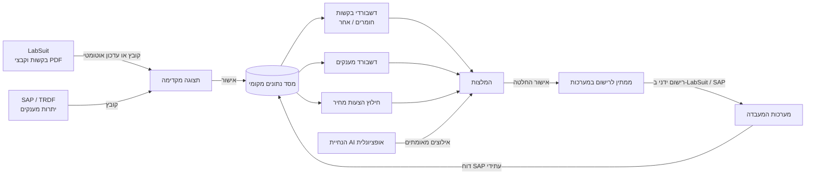

<div dir="rtl">

# GrantWise / LabFund

קישור לאתר: https://grantwise-production-730e.up.railway.app/

**מערכת מוצעת לתמיכה בהחלטות מימון במעבדת מחקר: מענקים, הזמנות, הצעות מחיר, מע״מ ומשאבים.**

`גרסת קוד 0.7.0` · `main` כולל פיתוחים פעילים אחרי 0.7.0 · Python 3.13 · Django 5.2 · PostgreSQL / SQLite · PuLP/CBC · Playwright · PyMuPDF · אוקטובר 2026

---

## בקצרה

GrantWise הוא שם המאגר, ו-LabFund הוא שם האפליקציה. המערכת נועדה לעזור למעבדה להחליט **מאיזה מענק לממן כל בקשה שאושרה**, בלי להחליף את SAP או את LabSuit.

המערכת המוצעת מרכזת ייצואי נתונים מ-LabSuit ומ-SAP, בונה תמונת מצב מקומית של בקשות, יתרות וסעיפים תקציביים, ומחשבת המלצות מימון שמכבדות יתרות, תאריכי סיום, מטבעות, מע״מ, סעיפי תקציב והחלטות שכבר התקבלו. ההחלטה נשמרת ב-LabFund כתיעוד פנימי, אבל הרישום הרשמי עדיין נעשה ידנית במערכות המעבדה.

העיקרון המנחה: **מקור האמת נשאר במערכות הקיימות; LabFund היא שכבת תפעול, בקרה והמלצה מעליהן.**

---

## הבעיה שהמערכת פותרת

במעבדת מחקר טיפוסית יש כמה מענקים פעילים במקביל, מטבעות שונים, תאריכי סיום שונים, כללי שימוש שונים, והזמנות שמתקדמות בשלבים שונים. המידע מפוזר בין שתי מערכות:

| מקור | מה הוא נותן | מה חסר ממנו |
|---|---|---|
| **LabSuit** | בקשות רכש, סטטוסים, מבקשים, פריטים, ספקים, קבצי הצעת מחיר ותוויות מימון | אין מקור נוח לתמונת תקציב מלאה; חלק מהבקשות חסרות סכום או סעיף |
| **SAP / TRDF** | יתרות מענקים לפי סעיפים תקציביים | אין תמונה של בקשות שעדיין לא נכנסו ל-SAP; הנתונים תלויים בדוח האחרון שהופק |

לכן החלטה פשוטה לכאורה, כמו “מאיזה מענק לשלם את ההזמנה הזו?”, דורשת חיבור ידני של כמה שיקולים:

- האם יש יתרה בסעיף התקציבי המתאים.
- האם המענק עומד להסתיים, וכדאי לנצל אותו לפני שיתרתו תחזור.
- האם מדובר בחומרים עם מע״מ, או בבקשה אחרת שבה המע״מ לא משנה את הסכום.
- האם המענק משלם מע״מ או רק סכום לפני מע״מ.
- האם ההזמנה כבר נרשמה ב-SAP, ממתינה לרישום, או עדיין החלטה פנימית בלבד.
- האם קיימות הוראות נקודתיות של מנהל/ת המעבדה, למשל “לא להשתמש במענק הזה בינתיים”.

---

## המערכת המוצעת

LabFund מציעה שכבה אחת שמחברת בין הנתונים, תהליך העבודה וההחלטה:

1. **קליטת נתונים מבוקרת** מקובצי SAP/LabSuit או מעדכון אוטומטי מ-LabSuit. כל ייבוא עובר תצוגה מקדימה לפני שמירה.
2. **נרמול נתונים מקומי**: בקשות, מענקים, סעיפים תקציביים, שערי חליפין, קבצי PDF של הצעות מחיר והיסטוריית ייבוא.
3. **דשבורדים נערכים במקום**: הטבלאות הן גם מסך צפייה וגם מסך עריכה. שינוי בתא נשמר דרך API אחיד.
4. **חילוץ סכומים מהצעות מחיר**: לבקשות חומרים נשמר PDF ההצעה, וממנו מחולצים סכומים לפני ואחרי מע״מ עם ראיית מקור.
5. **מנוע המלצות**: אופטימיזציה בשלמים שמקצה כל בקשה למענק אחד, לפי יתרות וסעיפים, מטבע, מע״מ, דחיפות ופרמטרים תפעוליים.
6. **הנחיות AI כאילוצים**: המשתמש יכול לכתוב הוראה חופשית בעברית; המודל מתרגם אותה לאילוצים סגורים בלבד, והאופטימיזציה נשארת זו שמקצה כסף.
7. **מעקב אחרי החלטות**: אחרי אישור, הסכום יורד מהזמין כממתין עד ש-SAP מכסה אותו בדוח עתידי.



---

## מה המערכת לא עושה

- היא לא מחליפה ERP ולא מחליפה את SAP.
- היא לא כותבת אוטומטית ל-SAP או ל-LabSuit.
- היא לא מנהלת את תהליך אישור הרכש עצמו; האישור נשאר ב-LabSuit.
- היא לא מניחה שהיתרות המקומיות הן הדוח הרשמי. הן תמונה תפעולית שמבוססת על הדוח האחרון ועל החלטות שהתקבלו מאז.
- ה-AI לא מקצה תקציב ולא מאשר החלטות. הוא רק מתרגם הנחיות לאילוצים שמערכת החישוב מאמתת.

---

## מסכי העבודה

| מסך | תפקיד |
|---|---|
| **הזמנות חומרים** | בקשות חומריות מ-LabSuit. כאן נמצאים העדכון האוטומטי, קובץ הצעת המחיר, סכום כולל מע״מ, סכום לפני מע״מ ומטבע ההצעה. |
| **אחר** | בקשות שאינן חומרים, למשל שכר או שירותים. במסך הזה עובדים עם סכום אחד מוקלד, ומע״מ לא משנה את החישוב. |
| **מענקים** | יתרות מענקים לפי סעיפי SAP, מטבע, תאריך סיום, סטטוס פעיל, האם המענק משלם מע״מ, סכום ממתין וזמין. |
| **המלצות** | כל הבקשות הפתוחות שממתינות להחלטה, עם מענק מומלץ, אפשרות לשנות מענק, לבחור אילו בקשות נכנסות לחישוב ולאשר החלטות. |
| **הגדרות** | שערי חליפין, מטבעות במעקב ומשתמשים. |

הדף הראשי של האפליקציה מפנה למסך הזמנות החומרים, כי זהו בדרך כלל המקום שבו מתחיל תהליך העבודה היומי.

---

## תהליך עבודה מומלץ

### 1. עדכון נתונים

- מעלים דוח SAP/TRDF במסך **מענקים**.
- מעדכנים את בקשות LabSuit במסך **הזמנות חומרים**, מקובץ או דרך **עדכון אוטומטי**.
- כל עדכון נפתח קודם בתצוגה מקדימה: שורות חדשות, שורות שישתנו, שורות שיוסתרו, אזהרות והחלטות ש-SAP כבר מכסה.
- שום דבר לא נשמר עד שלוחצים על אישור.

### 2. השלמת נתונים חסרים

- בקשת חומרים משתמשת בסכומי הצעת המחיר: כולל מע״מ ולפני מע״מ.
- בקשה שאינה חומרים משתמשת בסכום אחד מוקלד.
- אם חסר סכום, מטבע או סעיף תקציבי, הבקשה תופיע בהמלצות עם סיבה ולא תקבל הקצאה עד השלמה.

### 3. חישוב המלצה

- נכנסים למסך **המלצות**.
- מסמנים אילו בקשות ייכנסו לחישוב.
- אפשר להוסיף הוראה בעברית דרך “העזר ב-AI”, למשל לשמור מענק מסוים להמשך או להעדיף מקור מימון מסוים.
- המערכת מחשבת מחדש ומראה את ההמלצה, הסיבה והיתרה שתישאר.

### 4. אישור ותיאום מול המערכות הרשמיות

- מאשרים את ההחלטות המסומנות.
- הבקשות המאושרות יוצאות ממסכי הבקשות ועוברות לסל החלטות בדף ההמלצות.
- רושמים ידנית ב-LabSuit את ה-GRANT_ID שנבחר.
- לאחר הרישום לוחצים **עודכן במערכות המעבדה**, או שהמערכת מזהה זאת אוטומטית בייבוא הבא אם LabSuit כבר מציג את אותו GRANT_ID.
- בדוח SAP הבא, החלטה שמכוסה לפי התאריך יוצאת מחישוב ה״ממתין״ כדי לא להפחית פעמיים.

---

## מנוע ההמלצות

הקוד המרכזי נמצא ב-`budget/resolve.py`.

המודל מתייחס לכל בקשה פתוחה כאל החלטת הקצאה אחת: **בקשה אחת ממומנת ממענק אחד**. זה תואם את אופן העבודה שבו בפועל רושמים GRANT_ID אחד להזמנה.

החישוב מתחשב בנתונים הבאים:

- יתרה זמינה לפי מענק ולפי סעיף תקציבי.
- סכומים שכבר אושרו ב-LabFund ועדיין לא נראו בדוח SAP.
- הזמנות שיצאו אחרי תאריך דוח SAP האחרון.
- תאריך התחלה וסיום של מענק.
- מטבע ההזמנה, מטבע המענק ושער החליפין הרלוונטי.
- האם הבקשה היא חומרית, והאם המענק משלם מע״מ.
- עדיפות מענק, מענקי רזרבה וכללים/שריונים שנשמרים במודל הנתונים.
- אילוצים זמניים שמגיעים מהמשתמש או משכבת ה-AI.

בבקשות חומרים, החישוב משתמש בכלל המע״מ החדש:

| סוג מענק | סכום שמחויב |
|---|---|
| מענק שמשלם מע״מ | סכום הצעת המחיר כולל מע״מ |
| מענק שלא משלם מע״מ | סכום הצעת המחיר לפני מע״מ |

בבקשות שאינן חומרים, המערכת משתמשת בסכום המוקלד כפי שהוא.

---

## AI Assist

שכבת ה-AI נמצאת ב-`budget/ai_assist.py` והיא אופציונלית. היא נועדה לאפשר למנהל/ת המעבדה לכתוב הנחיות טבעיות בעברית, בלי להגדיר ידנית אילוצים טכניים.

לדוגמה:

- “לא להשתמש כרגע במענק של הקרן הזו.”
- “עדיף לשמור את מענק 123456 להמשך.”
- “שכר צריך לצאת רק ממענקים של ספק מסוים.”
- “אם היורו חזק מהדולר, קודם להשתמש בדולר.”

המודל לא מקבל הרשאה להמציא החלטות או לאשר כסף. הוא מחזיר רק JSON עם סוגי אילוצים מוגדרים מראש, כמו `exclude_grant`, `avoid_grant`, `prefer_grant`, `pin`, `forbid`, `prefer_for_category`, `require_for_category` ו-`currency_order`. לאחר מכן הקוד המקומי מאמת שכל מספר מענק, בקשה, ספק וסעיף באמת קיימים, ורק אז מפעיל מחדש את מנוע ההמלצות.

האילוצים נשמרים ב-session של המשתמש בלבד. הם לא נכתבים למסד הנתונים ולא משנים החלטות שכבר אושרו.

---

## הצעות מחיר ו-PDF

בעדכון האוטומטי מ-LabSuit, הרובוט יכול לשמור את קובץ ה-PDF שמצורף לבקשה. הקובץ נשמר רק אחרי אישור תצוגת הייבוא המקדימה.

חילוץ הסכומים מה-PDF מתבצע בשתי שכבות:

1. חילוץ מקומי ושמרני באמצעות PyMuPDF, שמחפש רק סכומים סופיים מודפסים במפורש.
2. בדיקת Bedrock אופציונלית ומבוקרת למקרים שבהם רוצים לאשר נפילה ל-AI עבור בקשה יחידה.

המערכת שומרת גם ראיית מקור: טקסט תומך, עמוד, מטבע וסטטוס חילוץ (`success`, `missing`, `ambiguous`, `failed`). עריכה ידנית של סכום מסומנת כך שלא תידרס בריצה חוזרת.

---

## ארכיטקטורה

המערכת היא אפליקציית Django אחת, עם מסד SQLite בפיתוח מקומי ו-PostgreSQL בפריסה.

```text
labfund/
├── labfund/                  # הגדרות Django, URL routing וגרסת האפליקציה
├── budget/                   # אפליקציית הליבה
│   ├── models.py             # מודל הנתונים: מענקים, בקשות, ייבואים, החלטות, קבצי PDF, שערים
│   ├── resolve.py            # מנוע ההמלצות והאישור
│   ├── amounts.py            # כללי סכום ומע״מ לפי סוג בקשה ומענק
│   ├── ai_assist.py          # תרגום הוראות משתמש לאילוצים מאומתים
│   ├── autofetch.py          # עדכון אוטומטי מ-LabSuit עם Playwright
│   ├── fx.py                 # שערי חליפין מבנק ישראל וממקור גיבוי
│   ├── funding.py            # סיווג ערכי GRANT_ID מ-LabSuit
│   ├── quote_extraction.py   # חילוץ שמרני של סכומי הצעת מחיר מ-PDF
│   ├── quote_bedrock.py      # קריאת Bedrock מבוקרת להצעות מחיר
│   ├── quote_storage.py      # שמירה ועדכון של תוצאות חילוץ הצעות מחיר
│   ├── tables.py             # מנוע הטבלאות הנערכות
│   ├── views.py              # דשבורדים, API לעריכה, ייבוא, המלצות והגדרות
│   ├── importers/            # קוראי קבצים ותצוגה מקדימה לייבוא
│   ├── management/commands/  # import_file, run_resolve, fetch_fx, extract_order_quotes ועוד
│   ├── templates/budget/     # תבניות המסכים
│   └── tests*.py             # בדיקות יחידה ואינטגרציה
├── docs/screenshots/         # צילומי מסך לתיעוד
├── requirements.txt
├── Dockerfile
├── railway.json
└── manage.py
```

---

## עקרונות פיתוח

- **ייבוא לפני אינטגרציה עמוקה.** המערכת בנויה סביב קבצים וקריאה אוטומטית מ-LabSuit, כי אין API יציב וזמין לשתי המערכות.
- **Preview לפני כתיבה.** כל עדכון נתונים משמעותי עובר dry run שמראה למשתמש מה ישתנה.
- **כסף נשמר כ-Decimal.** אין חישובי כסף ב-float. שער החליפין ששימש החלטה נשמר יחד עם ההחלטה.
- **החלטות נשמרות בנפרד מהמקור.** נתון שמגיע מ-LabSuit/SAP לא מוחק עריכה מקומית של המעבדה בלי אישור.
- **אופטימיזציה מופרדת מה-UI.** `resolve.py` מחשב ומאשר; ה-views רק אוספים קלט ומציגים תוצאה.
- **AI עם גבולות קשיחים.** המודל יכול להציע אילוצים מתוך אוצר מילים סגור בלבד. כל פלט עובר validation מקומי.
- **בדיקות בלי תלות ברשת.** מקורות חיצוניים, שערים, דפדפן אוטומטי ו-Bedrock נבדקים עם mock או תרחישי דמה.

---

## התקנה מקומית

דרישות: Python 3.12 ומעלה. המאגר מכוון ל-Python 3.13.

```bash
python -m venv .venv
source .venv/bin/activate
pip install -r requirements.txt
python -m playwright install chromium   # נדרש לעדכון האוטומטי מ-LabSuit
python manage.py migrate
python manage.py runserver
```

האתר יעלה בכתובת:

```text
http://127.0.0.1:8000
```

במיגרציה הראשונה נוצר משתמש מנהל רק אם אין משתמשים קיימים. ברירת המחדל היא `admin` / `admin`, ומומלץ להחליף אותה מיד דרך מסך המשתמשים.

---

## פקודות שימושיות

```bash
python manage.py test budget
python manage.py fetch_fx
python manage.py run_resolve
python manage.py import_file sap_grants TRDF-GRANTS-CLASS-BALANCES.XLS --as-of 2026-10-12 --mode replace
python manage.py import_file labsuit_orders orders_from_labsuit.xlsx --as-of 2026-10-12 --mode merge
python manage.py extract_order_quotes --limit 100
```

`extract_order_quotes` מריץ ברירת מחדל של preview בלבד. כדי לשמור תוצאות צריך להעביר `--save`. נפילה ל-Bedrock דורשת אישור מפורש לפי hash של ה-PDF, כדי למנוע שליחה לא מכוונת של נתונים חיצוניים.

---

## משתני סביבה מרכזיים

| משתנה | תפקיד |
|---|---|
| `SECRET_KEY` | מפתח Django. חובה להגדיר בפרודקשן. משמש גם להצפנת סיסמת LabSuit שנשמרת במערכת. |
| `DEBUG` | `1` בפיתוח, `0` בפרודקשן. |
| `DATABASE_URL` | חיבור למסד הנתונים. בהיעדרו משתמשים ב-SQLite מקומי. |
| `ALLOWED_HOSTS` | רשימת hosts מותרת. |
| `DEFAULT_ADMIN_USERNAME`, `DEFAULT_ADMIN_PASSWORD` | פרטי המשתמש הראשוני, לפני הפריסה הראשונה. |
| `FX_AUTO_REFRESH`, `FX_REFRESH_MINUTES` | שליטה ברענון שערי חליפין. |
| `LABSUIT_ORDERS_URL` | כתובת דף ההזמנות שממנו הרובוט מייצא נתונים. |
| `AUTOFETCH_DOWNLOAD_SECONDS` | כמה זמן לחכות לקובץ הייצוא מ-LabSuit. |
| `AUTOFETCH_PDFS` | האם להוריד קבצי PDF של הצעות מחיר בעדכון האוטומטי. |
| `AUTOFETCH_PDF_SECONDS`, `AUTOFETCH_PDF_PANEL_SECONDS` | תקציבי זמן להורדת PDF. |
| `QUOTE_BEDROCK_ENABLED` | הפעלת בדיקת Bedrock להצעות מחיר. |
| `AWS_BEARER_TOKEN_BEDROCK`, `AWS_REGION`, `BEDROCK_MODEL_ID` | הגדרות Bedrock עבור AI Assist ובדיקות PDF אופציונליות. |

---

## פריסה ל-Railway

המאגר כולל `Dockerfile` ו-`railway.json`. ה-Dockerfile מבוסס על תמונת Playwright הרשמית, כך ש-Chromium וספריות המערכת שלו זמינים גם בסביבת השרת.

תהליך פריסה בסיסי:

1. מחברים את המאגר ל-Railway.
2. מוסיפים שירות PostgreSQL.
3. מגדירים `SECRET_KEY`, `DEBUG=0`, פרטי admin ראשוניים, והגדרות Bedrock רק אם משתמשים בהן.
4. Railway מריץ build, אוסף static files, מפעיל migrations ומריץ את Gunicorn.

קובצי נתונים אמיתיים של המעבדה (`*.xls`, `*.xlsx`, `data/`) לא אמורים להיכנס ל-Git.

---

## בדיקות

הרצת הבדיקות:

```bash
python manage.py test budget
```

הבדיקות מכסות, בין היתר:

- ייבוא קבצי LabSuit ו-SAP.
- תצוגה מקדימה ושמירה רק לאחר אישור.
- חישוב המלצות, אישור, מחזור והתאמה מול SAP.
- טיפול במע״מ בבקשות חומרים מול בקשות אחרות.
- חילוץ הצעות מחיר מ-PDF ושמירה על תיקונים ידניים.
- AI Assist: validation, rate limit, אילוצים מותרים ושגיאות ספק.
- שערי חליפין ו-fallback בלי תלות ברשת אמיתית.

---

## מצב נוכחי ומגבלות ידועות

- `main` כולל יכולות שעדיין מסומנות ב-`CHANGELOG.md` כ-Unreleased, למרות שגרסת הקוד הרשמית היא עדיין 0.7.0.
- ל-LabSuit אין מזהה בקשה יציב בקובץ הייצוא, ולכן המערכת משתמשת במפתח טבעי. שינוי בפרטי הבקשה במקור עלול לגרום לה להיראות כבקשה חדשה.
- ההתאמה ל-SAP שמרנית ומבוססת על תאריכי דוחות והזמנות, כי דוח SAP אינו כולל את כל אירועי ההזמנה ברמת פירוט מלאה.
- כללי מענק ושריונים עדיין קיימים במודל הנתונים ומשפיעים על ההמלצות, אבל חלק ממסכי העריכה שלהם הוסרו זמנית מה-UI הנוכחי.
- הרשאות המשתמשים בסיסיות: מנהלים מנהלים משתמשים, ומשתמשים מחוברים יכולים לערוך את רוב נתוני העבודה. אין עדיין תפקיד צפייה בלבד.
- העדכון האוטומטי תלוי במבנה מסכי LabSuit ובטקסט כפתורים כמו `Login` ו-`Export`. שינוי באתר המקור עשוי לדרוש עדכון של הרובוט.

---

## היסטוריית שינויים

ראו [CHANGELOG.md](CHANGELOG.md) לפירוט הגרסאות והפיתוחים האחרונים.

</div>
