<div dir="rtl">

# LabFund

קישור לאתר: https://grantwise-production-730e.up.railway.app/

**כלי עזר להחלטות מימון במעבדת מחקר: מענקים, רכש ומשאבים**

`גרסה 0.7.0` · Python 3.13 · Django 5.2 · PostgreSQL / SQLite · PuLP (CBC) · אוקטובר 2026

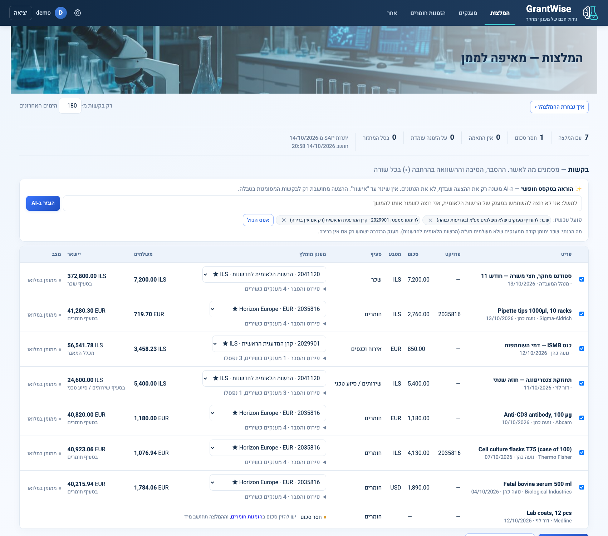

---

## תוכן עניינים

1. [הבעיה](#הבעיה)
2. [הפתרון](#הפתרון)
3. [מה LabFund לא עושה](#מה-labfund-לא-עושה)
4. [צורת העבודה](#צורת-העבודה)
5. [הדשבורדים](#הדשבורדים)
6. [המלצות: איך נבחרת ההמלצה](#המלצות-איך-נבחרת-ההמלצה)
7. [המודל המתמטי של ההמלצות](#המודל-המתמטי-של-ההמלצות)
8. [שערי חליפין](#שערי-חליפין)
9. [מודל הנתונים](#מודל-הנתונים)
10. [מבנה הקוד](#מבנה-הקוד)
11. [התקנה והרצה](#התקנה-והרצה)
12. [פריסה ל-Railway](#פריסה-ל-railway)
13. [בדיקות](#בדיקות)
14. [ממצאים מהנתונים האמיתיים](#ממצאים-מהנתונים-האמיתיים)
15. [מגבלות וצעדים הבאים](#מגבלות-וצעדים-הבאים)
16. [היסטוריית גרסאות](#היסטוריית-גרסאות)

---

## הבעיה

במעבדה כ-15 אנשים, כמה מענקים במקביל ממקורות שונים, ובכל אחד מטבע אחר (₪, דולר, יורו), תאריך סיום אחר וכללים משלו: מה מותר לקנות ומאיזה סעיף. המידע מפוזר בין שתי מערכות שלא מדברות זו עם זו:

| מערכת | מה יש בה | מה חסר |
|---|---|---|
| **LabSuit** | בקשות רכש (מי ביקש, מה, מתי, סטטוס) ותווית GRANT_ID | אין API. למרבית ההזמנות אין מחיר, והסטטוסים לא תמיד מתעדכנים |
| **SAP / TRDF** | יתרות מענקים לפי סעיף | אין API. התמונה מתעדכנת רק כשמייצאים דוח, ולא רואים בה בקשות שעוד לא הפכו להזמנת רכש |

לכן כל בקשה שאושרה מעלה את אותה שאלה: **מאיזה מענק לשלם?** התשובה תלויה בכמה דברים בבת אחת:

- מה היתרה בסעיף המתאים, ומה כבר "תפוס" על ידי החלטות שעוד לא הגיעו ל-SAP.
- איזה מענק עומד להסתיים ועלול להחזיר כסף.
- מה מוקצה מראש: משכורות, ומענקי רזרבה שעדיף לא לגעת בהם.
- המרת מטבע בין מחיר ההזמנה למטבע המענק.
- האם להתחלק בין שני מענקים כשאף אחד מהם לא מספיק לבד.

היום עושים את זה בגיליונות ובזיכרון. קשה לראות את התמונה המלאה, קל לפספס מענק שמסתיים, ואין תיעוד למה הוחלט מה שהוחלט.

## הפתרון

LabFund מחבר בין שתי המערכות **דרך ייבוא קבצים**, ומוסיף מעליהן שכבת החלטה:

1. **ייבוא** של ייצוא ההזמנות מ-LabSuit ושל יתרות המענקים מ-SAP (`.xlsx`, `.xls`, `.txt`), ב-Merge או ב-Replace, עם היסטוריה של כל ייבוא. את ייצוא ההזמנות LabFund יכול גם להוריד בעצמו (**עדכון אוטומטי**).
2. **דשבורדים שנערכים במקום.** כל טבלה היא גם המסך וגם העורך: לוחצים על תא, משנים, והשינוי נשמר. אין מסכי ניהול נפרדים.
3. **המלצות.** מסך שמחושב אוטומטית בכל כניסה. הוא מציג את כל הבקשות שאושרו ב-LabSuit ועוד לא הוזמנו, וממליץ מאיזה מענק לממן כל אחת. כמו בפועל, שבו מממנים בקשה על ידי רישום GRANT_ID אחד, כל בקשה ממומנת ממענק אחד. ההמלצה מגיעה מאופטימיזציה בשלמים על כל הבקשות ביחד, ובכל שורה אפשר לבחור מענק אחר.
4. **אישור ההחלטה משפיע על כל הדשבורדים.** הסכום שאושר מופיע כ"ממתין" ויורד מהזמין, עד שדוח SAP חדש מכסה את ההזמנה.
5. **תצוגה מקדימה לכל ייבוא.** לפני שקובץ נקלט, רואים מה ישתנה בדיוק, ושום דבר לא נשמר בלי אישור.
6. **שערי חליפין אוטומטיים** מבנק ישראל, עם גיבוי ממקור שני, בלי עדכון ידני.

### עקרונות

- **כלי עזר, לא ERP.** מקור האמת נשאר SAP ו-LabSuit. LabFund לא כותב אליהן דבר: אחרי אישור, רושמים ידנית את ה-GRANT_ID ב-LabSuit. העדכון האוטומטי רק **קורא** מ-LabSuit, כלומר מוריד ייצוא.
- **שום דבר לא נשמר בלי אישור.** ההמלצה מחושבת בזיכרון בכל כניסה, ונשמרת רק בלחיצה על "אישור".
- **נתוני המעבדה לא נדרסים.** שדות שהמעבדה ערכה (פרויקט, סעיף, סכום ידני, הגדרות מענק) נשמרים גם ב-Replace.
- **הכול מוסבר.** כל המלצה מגיעה עם נימוק, וכל בקשה שלא נכנסה לחישוב מופיעה עם הסיבה.

## מה LabFund לא עושה

- לא מתחבר ל-SAP. ל-LabSuit הוא מתחבר רק כדי להוריד ייצוא, ולא כותב אליה.
- לא מנהל תהליך אישור רכש. האישור נשאר ב-LabSuit.
- לא מחליף את הדוחות הרשמיים. היתרות ב-LabFund הן הערכה שמבוססת על הקובץ האחרון ועל ההחלטות שאושרו מאז.

---

## צורת העבודה

```mermaid
flowchart LR
  A[LabSuit<br/>הזמנות] -->|קובץ או עדכון אוטומטי| C[עדכון ממקור אחר]
  B[ייצוא מ-SAP<br/>יתרות מענקים] -->|קובץ| C
  C --> P[תצוגה מקדימה<br/>אישור או ביטול]
  P --> D[דשבורדים<br/>עריכה במקום]
  D --> E[המלצות<br/>המלצה ועריכה]
  E -->|אישור| F[ממתין ל-SAP<br/>בכל הדשבורדים]
  F -->|רישום GRANT_ID ב-LabSuit +<br/>"עודכן במערכות המעבדה"| G[LabSuit / SAP]
  G -->|דוח SAP הבא| H[כלול ביתרת SAP]
```

### 1. כניסה

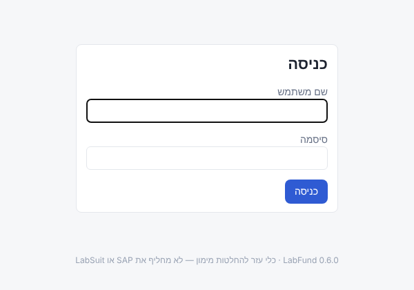

בהתקנה הראשונה נוצר משתמש **admin** עם סיסמה **admin**. כל עוד נכנסים עם הסיסמה הזו, מוצגת באתר תזכורת לשנות אותה (ראו [משתמש ברירת מחדל](#משתמש-ברירת-מחדל)).

### 2. הגדרה ראשונית (פעם אחת)

1. **עדכון הנתונים:** מענקים (יתרות TRDF) מקובץ, והזמנות מקובץ או בעדכון אוטומטי מ-LabSuit (ראו בהמשך).
2. **בדשבורד המענקים:** פותחים ▸ ליד כל מענק, ומגדירים בו עדיפות, רזרבה, ימי חסימה לפני הסיום, שריונים (למשל משכורות עד סוף המענק), כללים לכל סעיף ופרויקטים מורשים.
3. **בהגדרות:** פרויקטים ומשתמשים.

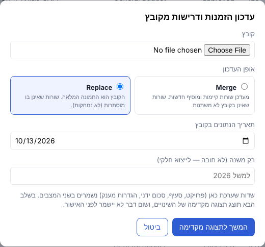

> **Merge** מעדכן שורות קיימות ומוסיף חדשות. **Replace** מתייחס לקובץ כאל התמונה המלאה, ושורות שלא מופיעות בו מוסתרות (לא נמחקות). **תאריך הנתונים** הוא התאריך שבו הדוח הופק, ולא תאריך ההעלאה. ממנו המערכת יודעת אילו הזמנות כבר כלולות ביתרת SAP. אם מעלים קובץ ישן יותר מהנתונים הפעילים, המערכת מבקשת אישור.

#### תצוגה מקדימה לפני כל עדכון

אחרי בחירת הקובץ, המערכת קוראת אותו ומחשבת את העדכון, אבל **לא שומרת דבר**. נפתח מסך שמראה מה בדיוק ישתנה:

- **ספירות:** כמה שורות חדשות, כמה ישתנו, כמה יוסתרו, כמה יחזרו לפעילות וכמה ללא שינוי.
- **שורות שישתנו:** לכל שורה, אילו שדות השתנו, מה היה ומה יהיה. בהזמנות מוצג גם סיכום של שינויי הסטטוס, למשל כמה עברו מ-ordered ל-received.
- **נשמר כמו שהוא:** הנתונים שהוגדרו ב-LabFund ולא מגיעים מהקובץ: פרויקטים, סכומים ידניים, הערות, החלטות מימון, הגדרות מענק, שריונים וכללים.
- **החלטות מימון שייכללו ביתרת SAP:** אילו החלטות יפסיקו לרדת מהזמין בעקבות הקובץ.
- **אזהרות:** ערכי GRANT_ID חדשים שהמערכת לא מזהה, עמודות או סיווגים של SAP שלא ממופים לסעיף, והזמנות עם החלטה מאושרת שנעלמו מהקובץ.

משם בוחרים **אישור ועדכון** או **ביטול**. אפשר גם לעבור בין Merge ל-Replace ולראות מיד מה ההבדל, בלי להעלות את הקובץ שוב.

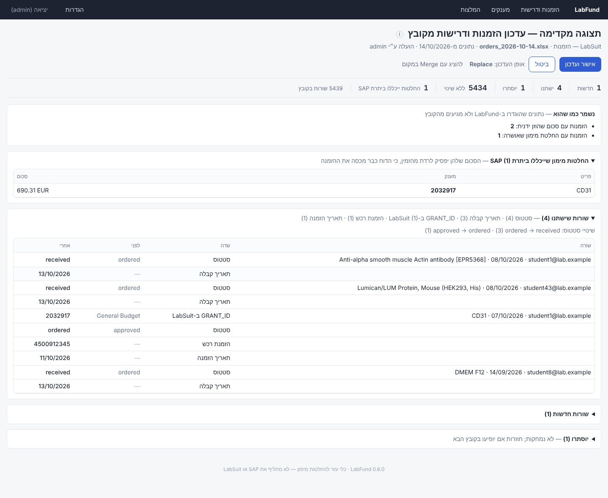

#### עדכון אוטומטי מ-LabSuit

בדשבורד **הזמנות ודרישות** הכפתור נקרא **"עדכון ממקור אחר"**, ונפתחות ממנו שתי אפשרויות: **עדכון מקובץ** (כמו קודם, עם Merge או Replace) ו**עדכון אוטומטי**.

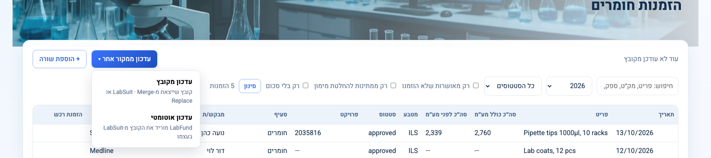

בעדכון האוטומטי נפתח חלון אישור. בפעם הראשונה מזינים בו שם משתמש וסיסמה ל-LabSuit. הם נשמרים פעם אחת, והסיסמה נשמרת מוצפנת ולא מוצגת שוב. בפעמים הבאות מוצג המשתמש השמור, ואפשר ללחוץ "שינוי שם משתמש וסיסמה" לפני האישור.

| בפעם הראשונה | כשיש משתמש שמור |
|---|---|
| 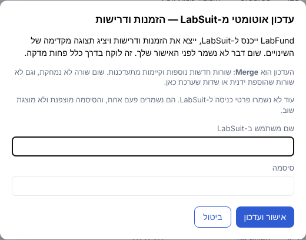 | 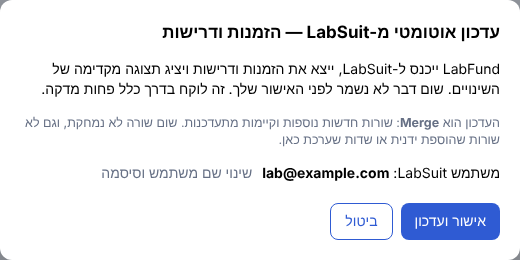 |

אחרי האישור מוצג מסך טעינה, ומאחורי הקלעים דפדפן אוטומטי (Playwright, בלי חלון):

1. נכנס לדף ההזמנות ב-LabSuit (`…/dashboard/?labId=3861#orders/status[]=approved`, הרשימה המסוננת של ההזמנות המאושרות).
2. מזין את שם המשתמש בשדה הראשון ואת הסיסמה בשדה השני, ולוחץ **Login**.
3. נכנס **שוב** לדף ההזמנות ומרענן אותו. אחרי ההתחברות LabSuit מעביר לדף הבית שלו, ובלי הרענון דף ההזמנות לא נטען.
4. לוחץ **Export** בצד הדף, ובחלון שקופץ באתר לוחץ שוב **Export**.
5. מחכה עד דקה לקובץ שיורד.
6. מעביר את הקובץ ל**תצוגה המקדימה ב-Merge**. משם ממשיכים כרגיל: אישור ועדכון, או ביטול.

**העדכון האוטומטי הוא תמיד Merge:** שורות חדשות נוספות, וקיימות מתעדכנות. שום שורה לא נמחקת: לא שורות שנעלמו מהייצוא, לא שורות שהוספתם ידנית ב"+ הוספת שורה", ולא שדות שערכתם ב-LabFund (פרויקט, סעיף, סכום ידני, הערות).

הכפתורים מזוהים לפי הטקסט שלהם ("Login", "Export") ולא לפי המיקום שלהם על המסך, כך ששינוי עיצוב באתר לא שובר את התהליך. שינוי שם של כפתור כן ישבור אותו. בבדיקה זה לקח כ-7 שניות מהלחיצה ועד שהתצוגה המקדימה נפתחה.

| בזמן הטעינה | התוצאה: תצוגה מקדימה ב-Merge |
|---|---|
| 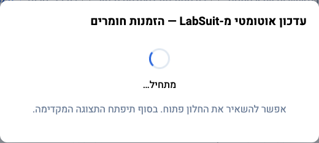 | 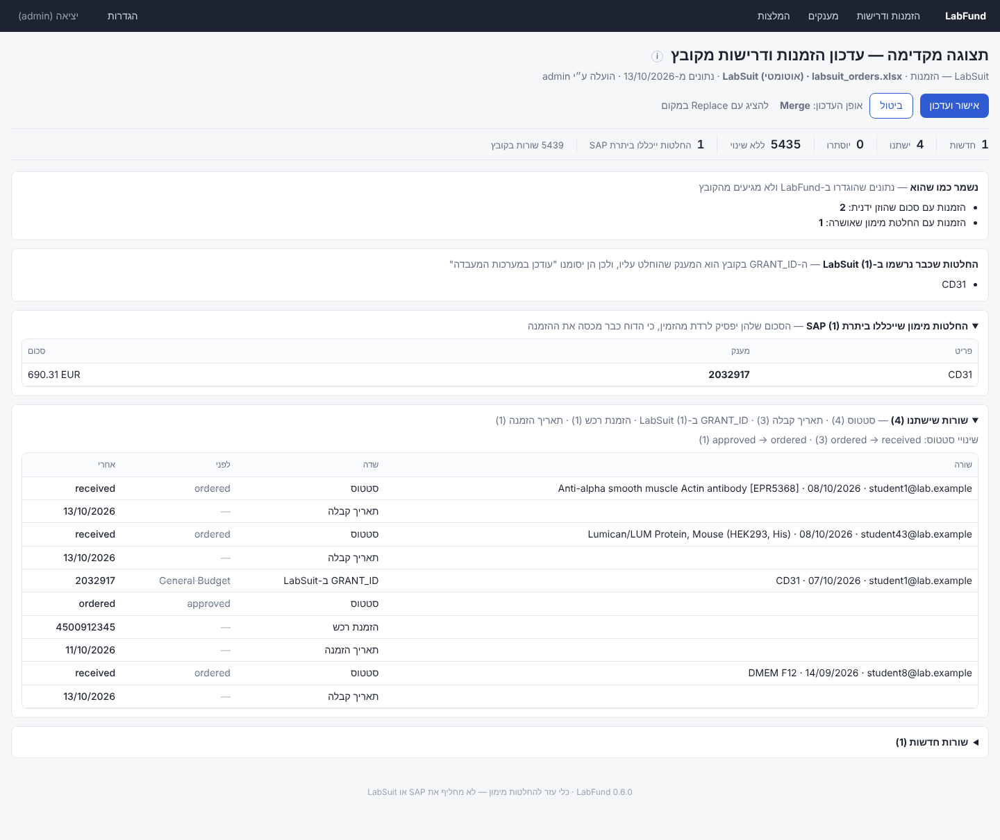 |

**אם משהו נכשל**, למשל סיסמה שגויה, כפתור שלא נמצא או קובץ שלא ירד תוך דקה, החלון מציג שהייתה בעיה בהבאת הנתונים האוטומטית וממליץ להביא אותם ידנית, עם כפתור שעובר ישר ל"עדכון מקובץ". ב"פרטים טכניים" יש גם צילום מסך של הרגע שבו התהליך נעצר, כדי שיהיה קל לראות מה השתנה באתר. גם קובץ ריק, או קובץ שאינו מהסוג הנכון (למשל ייצוא של דף אחר ב-LabSuit), נעצר כאן ולא מגיע לתצוגה המקדימה.

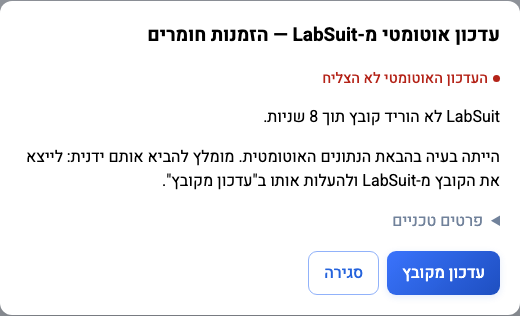

הכתובת שהרובוט נכנס אליה מוגדרת ב-`LABSUIT_ORDERS_URL`, וכך גם מספר השניות שהוא מחכה לקובץ (`AUTOFETCH_DOWNLOAD_SECONDS`).

**קובצי PDF.** מיד אחרי הייצוא, באותה כניסה, הרובוט עובר על כל בקשה בקובץ: טוען את כל הרשימה (היא נטענת בגלילה), לוחץ על שם הבקשה, ולוקח את הקובץ היחיד שמופיע תחת Files בחלונית הצד (הצעת המחיר של הספק). הקבצים נשמרים במסד הנתונים, ליד ההזמנה, בעמודה **"הצעת מחיר"** בדף ההזמנות ודרישות. כמו בשאר העדכון, שום דבר לא נשמר עד שמאשרים את התצוגה המקדימה, ובה מופיע דוח: כמה הורדו, כמה כבר שמורים, ואילו בקשות בלי קובץ או שלא נמצאו. קובץ שמספר ההצעה שלו לא תואם לבקשה לא נשמר, כדי שלא יצורף להזמנה הלא נכונה. בקשה שכבר יש לה קובץ מדולגת, כך שהריצה הראשונה ארוכה והבאות קצרות.

> **בהרצה על מחשב אישי** צריך להתקין פעם אחת את הדפדפן האוטומטי: `python -m playwright install chromium`. אם הוא חסר, החלון מציג את הפקודה הזו. בשרת Railway הוא כבר מותקן דרך ה-`Dockerfile`.

### 3. השגרה: כשיש בקשות חדשות

1. בדשבורד **הזמנות ודרישות**: "עדכון ממקור אחר", ואז **עדכון אוטומטי** (או עדכון מקובץ שייצאתם), ואישור התצוגה המקדימה.
2. נכנסים ל**המלצות**. כל הבקשות שאושרו ועוד לא הוזמנו מופיעות שם עם המלצה: מענק אחד לכל בקשה.
3. משלימים סכום לבקשה שאין לה, ובודקים את ההמלצה ואת "סיכום החלוקה".
4. אם רוצים, בוחרים מענק אחר לבקשה. הסיכום מתעדכן מיד.
5. **אישור המסומנות.**
6. רושמים ב-LabSuit את ה-GRANT_ID של המענק שנבחר, ולוחצים בהמלצות על **"עודכן במערכות המעבדה"** ליד ההחלטה. גם בלי ללחוץ: בעדכון ההזמנות הבא, LabFund מזהה שה-GRANT_ID ב-LabSuit הוא המענק שהוחלט עליו, ומסמן את ההחלטה בעצמו.

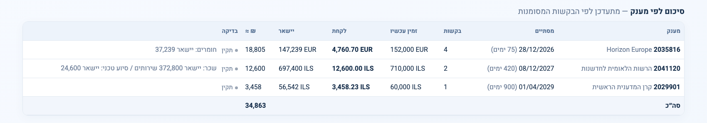

אחרי האישור, ההזמנות יוצאות מדף **הזמנות ודרישות** ועוברות ל**סל המחזור** בתחתית דף ההמלצות. בכל שורה בסל רואים את המענק שאושר, את **נימוק ההמלצה**, את הערך בשקלים בעת האישור (ואם השער או הסכום השתנו מאז, גם את הערך של היום) ומי אישר ומתי.

- **"♻ מחזור"** מבטל את האישור ומחזיר את ההזמנה לדף הזמנות ודרישות כבקשה פתוחה. ההמלצה תחושב מחדש לפי השערים והיתרות של היום, כך שמטבע ששערו השתנה יתומחר מחדש.
- **"עודכן במערכות המעבדה"**: לוחצים עליו אחרי שעדכנתם את LabSuit או את SAP. ההזמנה **נמחקת מהמערכת** (גם קובץ ה-PDF שלה), והסכום שלה **ממשיך לרדת מהמענק** (הוא לא חוזר אליו) עד שדוח SAP מכסה אותו. ההחלטה נשארת גלויה בפירוט המענק. אין דרך חזרה: אם LabSuit ישלח את אותה בקשה שוב בעדכון הבא, היא תיכנס כבקשה חדשה. אם LabSuit כבר מציג את ה-GRANT_ID שהוחלט, הסימון והמחיקה נעשים אוטומטית בעדכון ההזמנות.

כל בקשה פתוחה שמופיעה בדף הזמנות ודרישות מופיעה גם בטבלת הבקשות בדף ההמלצות. מי שאין לה המלצה מסומנת בסיבה: חסר סכום, ישנה מדי, כבר יש לה הזמנת רכש, או שהיא על הזמנה עומדת.

הסכום ממשיך לרדת מהזמין עד שדוח SAP יכסה את ההזמנה (ראו בהמשך). אם ל-LabSuit אין תאריך הזמנה, תאריך הסימון משמש במקומו.

### 4. פעם בשבוע: עדכון SAP

מעלים את דוח היתרות מ-SAP בדשבורד **מענקים**, עם התאריך האמיתי של הדוח. החלטה שהדוח מכסה עוברת אוטומטית ל"כלול ביתרת SAP" ויוצאת מ"ממתין", כך שהסכום לא יורד פעמיים.

SAP מייצא רק יתרות מצטברות, בלי שורות של הזמנות, ולכן "מכסה" היא הסקה לפי תאריכים: הדוח מכסה החלטה אם תאריכו לא מוקדם מהיום שבו ההזמנה יצאה. היום הזה הוא תאריך ההזמנה ב-LabSuit (כשיש מספר הזמנה ותאריך), ואם אין, היום שבו סומן "עודכן במערכות המעבדה". **החלטה בלי תאריך ידוע נשארת שמורה.** כך הזמין יכול לצאת שמרני מדי, אבל אף פעם לא גבוה מהמציאות.

---

## הדשבורדים

בכל הדשבורדים עובדים באותו אופן:

- **עריכה במקום.** לוחצים על תא, משנים, ו-Enter או יציאה מהתא שומרים. תא שנשמר מהבהב בירוק, ותא עם ערך לא תקין נצבע באדום.
- **"עדכון מקובץ"**, או **"עדכון ממקור אחר"** בהזמנות (קובץ או עדכון אוטומטי מ-LabSuit), ו-**"+ הוספת שורה"** בדשבורדים שזה רלוונטי להם.
- **ⓘ.** ההסבר מופיע ב-tooltip כשמרחפים על הסמל, כך שהמסך נשאר נקי:

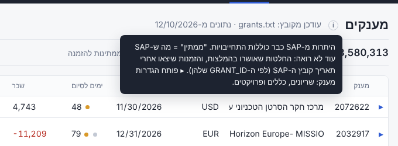

הלשוניות מסודרות כך: הזמנות ודרישות, מענקים, המלצות, ובקצה הגדרות.

| דשבורד | מקור הנתונים | הוספת שורה | עיקר התוכן |
|---|---|---|---|
| **הזמנות ודרישות** | ייצוא הזמנות מ-LabSuit, מקובץ או אוטומטית | ✓ | סינון לפי שנה, סטטוס, "רק מאושרות שלא הוזמנו" ו"רק בלי סכום" |
| **מענקים** | יתרות TRDF מ-SAP | ✓ | יתרה לפי סעיף, ממתין, זמין ושווי בש״ח, ימים לסיום עם נקודת סטטוס. ▸ פותח את הגדרות המענק ואת ההחלטות שהתקבלו לגביו |
| **המלצות** | — | — | המלצת מימון לכל בקשה פתוחה, עריכה, ואישור |
| **הגדרות** | — | ✓ | שלוש לשוניות: שערי חליפין, פרויקטים ומשתמשים |

### מענקים

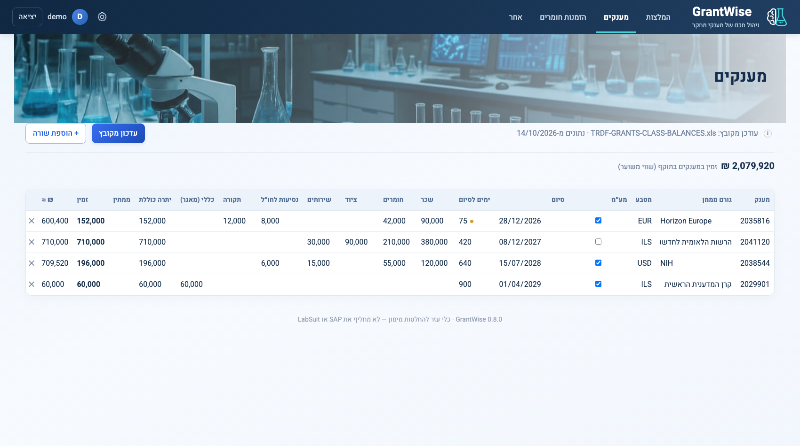

- **ימים לסיום:** נקודה כתומה כשהמענק מתקרב לסיום ועדיין יש בו יתרה, ונקודה אדומה כשהמענק הסתיים ונשארה בו יתרה.
- **ממתין:** סכום ההחלטות שאושרו ב-LabFund ו-SAP עוד לא רואה.
- **זמין** = יתרת SAP − שריונים − ממתין − הזמנות שיצאו אחרי תאריך הדוח.
- מתחת ליתרת הסעיף מופיעה השורה **"אחרי החלטות"**, כלומר מה נשאר בסעיף אחרי ההחלטות שאושרו.

לחיצה על ▸ פותחת את הגדרות המענק ואת טבלת **"החלטות מימון מהמענק"**, שמראה איזו הזמנה קיבלה כמה, מאיזה סעיף ובאיזה מצב:

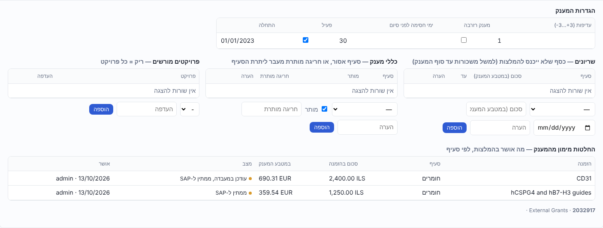

### הזמנות ודרישות

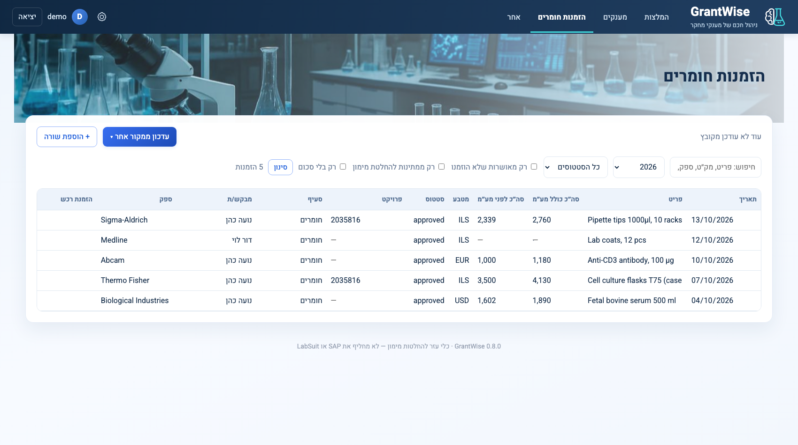

הזמנות שאושרו בהמלצות לא מופיעות בדף הזה: הן ממתינות ב**סל המחזור** בדף ההמלצות, ואחרי "עודכן במערכות המעבדה" הן יוצאות מהמערכת. מי שהחלטת המימון שלה בוטלה ב"♻ מחזור" חוזרת לכאן כבקשה פתוחה. ערכי GRANT_ID ש-LabSuit שולח מזוהים אוטומטית: מספר מענק, הזמנה עומדת / שמור-מכור (כבר מחויבת ב-SAP, ולכן לא נכנסת להמלצות), או "פתוח" (ההחלטה נשארת להמלצות).

### הגדרות

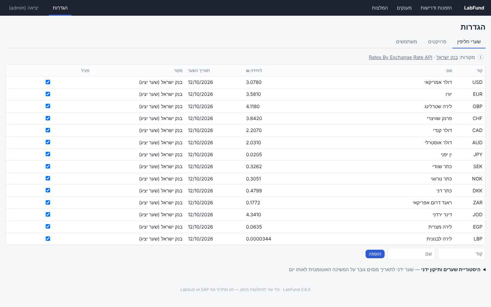

- **שערי חליפין:** המטבעות שמתעדכנים אוטומטית. הוספת מטבע לפי קוד בן 3 אותיות, היסטוריית שערים ותיקון ידני.
- **פרויקטים:** רשימת הפרויקטים שאפשר לבחור בכל הדשבורדים, כולל פרויקט-על. הזמנה בלי פרויקט מוצגת עם "-".
- **משתמשים:** הוספה, הרשאת מנהל, השבתה ושינוי סיסמה. זמין למנהלים בלבד.

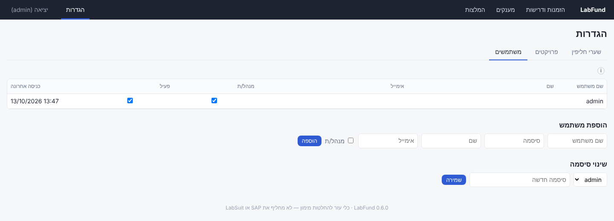

> הצילומים צולמו על ייצוא אמיתי מ-12/10/2026. כתובות המייל של המבקשים הוחלפו בכתובות בדויות, ושערי החליפין בצילומים הם להמחשה בלבד.

---

## המלצות: איך נבחרת ההמלצה

הקוד נמצא ב-`budget/resolve.py`.

### מה נכנס לחישוב

| נכנס | לא נכנס (מופיע תחת "אושרו אבל לא בחישוב", עם סיבה) |
|---|---|
| בקשה שסטטוס ה-LabSuit שלה הוא `approved` ושעוד לא הוזמנה | בקשה שיש לה מספר הזמנת רכש ותאריך הזמנה ≤ תאריך דוח ה-SAP, כלומר כבר כלולה ביתרות |
| מ-180 הימים האחרונים (ניתן לשינוי) | בקשה על הזמנה עומדת או שמור-מכור |
| | בקשה שכבר יש לה החלטה מאושרת ב-LabFund |

### כמה זמין בכל מענק

```
זמין(מענק, סעיף) = יתרת SAP (כבר נטו מהתחייבויות)
                 − שריונים בתוקף
                 − החלטות שאושרו ב-LabFund ועוד לא כלולות ביתרת SAP
                 − הזמנות שיצאו אחרי תאריך דוח ה-SAP (לפי ה-GRANT_ID שלהן)
```

### כשירות

מענק נחשב כשיר לבקשה רק אם כל התנאים הבאים מתקיימים:

- המענק פעיל, ותאריך הסיום פחות ימי החסימה (ברירת המחדל: 30) עוד לא עבר.
- הסעיף מותר במענק: לפי הכללים, או לפי קיום יתרה בסעיף.
- הפרויקט של הבקשה מורשה במענק, כולל דרך פרויקט-העל. מענק בלי פרויקטים מורשים פתוח לכל פרויקט.

### האופטימיזציה

אופטימיזציה בשלמים (PuLP + CBC) על **כל הבקשות ביחד**. כך שתי בקשות לא "מתחרות" על אותה יתרה בלי שהמערכת יודעת על כך.

- **מענק אחד לכל בקשה.** במעבדה מממנים בקשה על ידי רישום GRANT_ID אחד ב-LabSuit, ולכן ההמלצה בוחרת לכל בקשה מענק אחד שמכסה את כל הסכום.
- **אין מענק אחד שמספיק?** הבקשה מסומנת "אין מקור מספיק", עם הסבר, ואינה מקבלת המלצה.
- **אילוצים:**
  - לא לעבור את היתרה בסעיף ולא את היתרה הכוללת של המענק.
  - ההמרה למטבע המענק כוללת מרווח ביטחון של 3% כשהמטבעות שונים.
- **מטרה:** לממן כמה שיותר, ובין האפשרויות לבחור את הזולה ביותר לפי העלות לכל ₪, כשנמוך יותר עדיף:

```
cost = 1 − 0.6·urgency + 0.5·reserve − 0.1·(priority + project_weight) + 0.05·fx_mismatch
urgency = 0.5 ^ (days_to_end / 90)
```

  כלומר: מענק שמסתיים בקרוב מקבל עדיפות, מענק רזרבה נשמר לסוף, ועדיפות ה-PI והעדפת הפרויקט מטות את הבחירה. המרת מטבע מקבלת קנס קטן.

כל המשקלים נמצאים ב-`RESOLVE_DEFAULTS` ב-`labfund/settings.py`. הניסוח הפורמלי המלא נמצא ב[המודל המתמטי של ההמלצות](#המודל-המתמטי-של-ההמלצות).

### עריכה ואישור

- **עריכה:** בכל שורה אפשר לבחור מענק אחר (רק מבין הכשירים).
  - "סיכום לפי מענק" מתעדכן מיד, ומסמן חריגה מסעיף או חריגה מיתרה.
  - **↻ רענון המלצה** מחזיר את כל השורות להמלצה המיטבית.
- **אישור** (`approve_plans`):
  - כל ההחלטות נבדקות מחדש מול יתרות עדכניות, בטרנזקציה אחת שבה המענקים נעולים (`select_for_update`).
  - הכול או כלום: אם משהו לא תקין, שום דבר לא נשמר והשגיאות מוצגות.
  - בכל הקצאה נשמרים השער ותאריכו.
- **"עודכן במערכות המעבדה"** (`allocation_lab_updated`): מסמן את כל שורות ההחלטה של ההזמנה, עם המשתמש והתאריך. הסימון לא משחרר את השריון. לחיצה נוספת מבטלת אותו.
  - **זיהוי אוטומטי** (`mark_written_in_labsuit`): בכל עדכון הזמנות, החלטה של מענק אחד שה-GRANT_ID שלה ב-LabSuit הוא אותו מענק מסומנת לבד, בשם "LabSuit (GRANT_ID)". התצוגה המקדימה מראה אילו החלטות יסומנו.
- **התאמה ל-SAP** (`reconcile`, `covered_by_sap`):
  - רצה בייבוא קובץ SAP או LabSuit ובסימון "עודכן במערכות המעבדה", ואף פעם לא בכניסה לדף.
  - החלטה עוברת ל"כלול ביתרת SAP" רק כשתאריך דוח ה-SAP לא מוקדם מתאריך יציאת ההזמנה: תאריך ההזמנה ב-LabSuit, או תאריך הסימון אם אין.
  - החלטה בלי תאריך ידוע נשארת שמורה. הזמנה עם מספר הזמנה ובלי תאריך כבר לא נחשבת כלולה.

אפשר להריץ את ההמלצות גם משורת הפקודה, לקריאה בלבד, כולל backtest:

```bash
python manage.py run_resolve                            # ההמלצה הנוכחית
python manage.py run_resolve --replay-days 60 --brief   # מה היה מומלץ ב-60 הימים האחרונים
```

---

## המודל המתמטי של ההמלצות

המודל הוא **תכנית בשלמים**: כל בקשה ממומנת ממענק אחד בדיוק, כמו שרושמים GRANT_ID אחד ב-LabSuit. מבחינה מתמטית זו בעיית השמה מוכללת (Generalized Assignment Problem), עם אילוצי קיבולת גם לכל סעיף. בקוד (`compute` ב-`budget/resolve.py`) הוא כתוב כבעיית מינימום של עלות, ובהמשך הסעיף יש גם הצורה השקולה כבעיית מקסימום.

### קבוצות

| סימון | משמעות |
|---|---|
| <span dir="ltr">$`O`$</span> | הבקשות שנכנסו לחישוב: אושרו ב-LabSuit, עוד לא הוזמנו, ויש להן סכום |
| <span dir="ltr">$`G`$</span> | המענקים הפעילים שיש להם שער חליפין לתאריך ההחלטה |
| <span dir="ltr">$`C`$</span> | סעיפי התקציב. לכל בקשה סעיף אחד, <span dir="ltr">$`c(o)`$</span> |
| <span dir="ltr">$`P \subseteq G`$</span> | מענקים "מאוחדים" (עם יתרה בסעיף כללי). בהם נבדקת רק היתרה הכוללת |
| <span dir="ltr">$`E \subseteq O \times G`$</span> | הזוגות הכשירים (ראו [כשירות](#כשירות)) |
| <span dir="ltr">$`G_o,\ O_g`$</span> | המענקים הכשירים לבקשה <span dir="ltr">$`o`$</span>, והבקשות שהמענק <span dir="ltr">$`g`$</span> כשיר להן |

### פרמטרים

| סימון | משמעות |
|---|---|
| <span dir="ltr">$`A_o`$</span> | סכום הבקשה ב-₪ (הסכום במטבע ההזמנה כפול השער) |
| <span dir="ltr">$`\rho_g`$</span> | ₪ ליחידה אחת של מטבע המענק |
| <span dir="ltr">$`\mu_{og}`$</span> | מרווח ביטחון במטבע: <span dir="ltr">$`0.03`$</span> כשמטבע ההזמנה שונה ממטבע המענק, אחרת <span dir="ltr">$`0`$</span> |
| <span dir="ltr">$`k_{og}`$</span> | המרה מ-₪ למטבע המענק, כולל המרווח: <span dir="ltr">$`k_{og} = (1+\mu_{og})/\rho_g`$</span> |
| <span dir="ltr">$`T_g`$</span> | הזמין הכולל במענק, במטבע המענק: יתרת SAP, פחות שריונים, פחות החלטות שעוד לא כלולות ביתרת SAP, פחות הזמנות שיצאו אחרי תאריך הדוח |
| <span dir="ltr">$`B_{gc}`$</span> | הזמין בסעיף <span dir="ltr">$`c`$</span> (אותו חישוב ברמת הסעיף), ועוד חריגה מותרת לפי כללי המענק |
| <span dir="ltr">$`\gamma_{og}`$</span> | עלות לכל ₪ מהמענק <span dir="ltr">$`g`$</span> לבקשה <span dir="ltr">$`o`$</span> (ראו בהמשך) |
| <span dir="ltr">$`M = 1000`$</span> | קנס על כל ₪ שלא נמצא לו מימון (`BIG`) |

### משתני החלטה

- <span dir="ltr">$`y_{og} \in \{0,1\}`$</span>: 1 אם הבקשה <span dir="ltr">$`o`$</span> ממומנת כולה מהמענק <span dir="ltr">$`g`$</span>, לכל <span dir="ltr">$`(o,g) \in E`$</span>.
- <span dir="ltr">$`z_o \in \{0,1\}`$</span>: 1 אם אין לבקשה מענק אחד שמכסה אותה ("אין מקור מספיק").

### הבעיה: מענק אחד לכל בקשה (ברירת המחדל)

```math
\begin{aligned}
\min_{y,\,z}\quad & \sum_{(o,g)\in E} \gamma_{og}\,A_o\, y_{og} \;+\; M \sum_{o\in O} A_o\, z_o \\[6pt]
\text{s.t.}\quad
& \sum_{g\in G_o} y_{og} + z_o = 1 && \forall\, o\in O && \text{(1)} \\
& \sum_{o\in O_g} k_{og}\,A_o\, y_{og} \le \max(T_g,\,0) && \forall\, g\in G && \text{(2)} \\
& \sum_{o\in O_g:\ c(o)=c} k_{og}\,A_o\, y_{og} \le \max(B_{gc},\,0) && \forall\, g\in G\setminus P,\ c\in C && \text{(3)} \\
& y_{og},\ z_o \in \{0,1\}
\end{aligned}
```

- **(1) בחירה אחת:** כל בקשה מקבלת מענק אחד בדיוק, או מסומנת "אין מקור מספיק".
- **(2) יתרה כוללת:** סך הבקשות שמשויכות למענק לא עובר את הזמין בו.
- **(3) יתרה בסעיף:** במענק שאינו מאוחד, גם כל סעיף בנפרד לא עובר את הזמין בו.

<span dir="ltr">$`A_o`$</span> ופונקציית המטרה ב-₪, ולכן אפשר להשוות בין מענקים במטבעות שונים. האילוצים במטבע של כל מענק, כי שם נמדדת היתרה בפועל, ו-<span dir="ltr">$`k_{og}`$</span> מתרגם ביניהם.

### פונקציית העלות

```math
\gamma_{og} \;=\; \max\Big(0.05,\;\; 1 \;-\; w_u\,U_g \;+\; w_r\,R_g \;-\; w_p\,(\pi_g + \omega_{og}) \;+\; w_{fx}\,\mathbf{1}\big[\mathrm{cur}(o)\ne \mathrm{cur}(g)\big]\Big)
```

```math
U_g = 0.5^{\,\max(d_g,\,0)/h},\qquad h = 90
```

| רכיב | משמעות | משקל |
|---|---|---|
| <span dir="ltr">$`U_g`$</span> | **דחיפות.** <span dir="ltr">$`d_g`$</span> הוא מספר הימים עד סוף המענק (3650 כשאין תאריך סיום). מענק שמסתיים בעוד 90 יום מקבל 0.5, ומענק שמסתיים עכשיו מקבל כמעט 1 | <span dir="ltr">$`w_u = 0.6`$</span> |
| <span dir="ltr">$`R_g`$</span> | **רזרבה** (0 או 1). מענק רזרבה יקר יותר, ולכן נשמר לסוף | <span dir="ltr">$`w_r = 0.5`$</span> |
| <span dir="ltr">$`\pi_g`$</span> | עדיפות ה-PI למענק, בין 3- ל-3 | <span dir="ltr">$`w_p = 0.1`$</span> |
| <span dir="ltr">$`\omega_{og}`$</span> | העדפת הפרויקט של הבקשה למענק, בין 3- ל-3 | <span dir="ltr">$`w_p = 0.1`$</span> |
| <span dir="ltr">$`\mathbf{1}[\cdot]`$</span> | קנס קטן על המרת מטבע | <span dir="ltr">$`w_{fx} = 0.05`$</span> |

המשקלים מוגדרים ב-`RESOLVE_DEFAULTS` ב-`labfund/settings.py`.

### הכשירות מגדירה את <span dir="ltr">$`E`$</span>

כללים שהם "כן או לא" לא נכתבים כאילוצים. הם קובעים מראש אילו משתנים קיימים. הזוג <span dir="ltr">$`(o,g)`$</span> שייך ל-<span dir="ltr">$`E`$</span> רק אם מתקיימים כל התנאים:

1. <span dir="ltr">$`d_g`$</span> לא קטן מימי החסימה של המענק (ברירת המחדל: 30).
2. המענק מתחיל לכל המאוחר 30 יום מהיום.
3. אם לפרויקט של הבקשה יש מענקים מקושרים (כולל דרך פרויקט-העל), <span dir="ltr">$`g`$</span> הוא אחד מהם. בקשה בלי פרויקט יכולה להיות ממומנת מכל מענק.
4. הסעיף <span dir="ltr">$`c(o)`$</span> לא אסור בכללי המענק.
5. <span dir="ltr">$`T_g > 0`$</span>. אם המענק לא מאוחד, נדרש גם <span dir="ltr">$`B_{g,c(o)} > 0`$</span>.
6. אם הופעלה האפשרות "לשמור את המענק שסומן ב-LabSuit" והמענק המסומן כשיר, <span dir="ltr">$`G_o`$</span> מצטמצם למענק הזה בלבד.

### הניסוח כבעיית מקסימום

מאילוץ (1) נובע <span dir="ltr">$`z_o = 1 - \sum_g y_{og}`$</span>. מציבים בפונקציית המטרה:

```math
\sum_{(o,g)\in E}\gamma_{og}A_o\,y_{og} \;+\; M\sum_{o}A_o\Big(1-\sum_{g}y_{og}\Big)
\;=\; \underbrace{M\sum_{o}A_o}_{\text{const}} \;-\; \sum_{(o,g)\in E}\big(M-\gamma_{og}\big)A_o\,y_{og}
```

ולכן הבעיה שקולה בדיוק לבעיה:

```math
\begin{aligned}
\max_{y}\quad & \sum_{(o,g)\in E} v_{og}\,A_o\,y_{og}, \qquad v_{og} = M-\gamma_{og} \\[4pt]
\text{s.t.}\quad & \sum_{g\in G_o} y_{og} \le 1 \quad \forall\, o\in O, \qquad \text{(2)},\ \text{(3)}, \qquad y_{og}\in\{0,1\}
\end{aligned}
```

כלומר, **ממקסמים את "ערך המימון" הכולל.** כל ₪ שממומן שווה כמעט <span dir="ltr">$`M`$</span>. ההפרש הקטן <span dir="ltr">$`\gamma_{og}`$</span> מעדיף מענק שמסתיים בקרוב, מענק שאינו רזרבה, מענק עם עדיפות גבוהה, ומענק באותו מטבע.

### מאפייני המודל

**סדר העדיפויות.** <span dir="ltr">$`\gamma`$</span> נע בין 0.05 לכ-1.55, הרבה מתחת ל-<span dir="ltr">$`M`$</span>. לכן המודל קודם כול מממן כמה שיותר ₪, ורק אחר כך בוחר מאיפה. זה קירוב בשיטת קנס לסדר לקסיקוגרפי, ולא סדר לקסיקוגרפי מדויק. בגדלים של מעבדה אין ביניהם הבדל מעשי.

**בלי פיצול, גם כשזה עולה במימון.** אם בקשה גדולה מכל מענק בודד, היא תסומן "אין מקור מספיק" גם כשכמה מענקים יחד היו מכסים אותה. כך מממנים במעבדה: GRANT_ID אחד לכל הזמנה.

**כל הבקשות נפתרות ביחד.** גישה חמדנית, שנותנת לכל בקשה בתורה את המענק הזול לה, עלולה לנצל על הבקשה הראשונה מענק שהשנייה צריכה יותר. בפתרון משותף זה לא קורה. למשל, אם מענק שמסתיים בקרוב יכול להכיל רק אחת משתי בקשות, הוא יקבל את זו שמנצלת אותו הכי טוב, והשנייה תעבור למענק אחר.

**סיבוכיות וגודל.** בעיית השמה מוכללת היא NP-קשה במקרה הכללי, אבל בגדלים של מעבדה היא קטנה מאוד: <span dir="ltr">$`|E| + |O|`$</span> משתנים בינאריים, ו-<span dir="ltr">$`|O| + |G| + \sum_{g \notin P} |C_g|`$</span> אילוצים. CBC פותר אותה לאופטימום. ב-backtest על 108 בקשות ו-16 מענקים זה לקח פחות משנייה. הזמן מוגבל ל-30 שניות, ואם הוא נגמר, CBC מחזיר את הפתרון הטוב ביותר שמצא.

**מה לא בתוך המודל:**
- עיגול לאגורות.
- העריכה הידנית של המשתמש.
- הבדיקה מחדש באישור (`approve_plans`). היא בודקת שוב את (2) ו-(3) מול יתרות עדכניות, בטרנזקציה נעולה, והיא נפרדת מהמודל.

---

## שערי חליפין

- **עדכון אוטומטי.** middleware בודק בכל כניסה לדף אם עברה יותר משעה (`FX_REFRESH_MINUTES`). אם עברה, הוא מושך שערים חדשים. אם המשיכה נכשלה, הוא מנסה שוב רק אחרי 10 דקות, כך שהדף לא נתקע.
- **מקור ראשי:** השער היציג של בנק ישראל (`boi.org.il/PublicApi/GetExchangeRates`). השדה `unit` מטופל: JPY מצוטט ל-100 יחידות, ו-LBP ל-10.
- **מקור גיבוי:** ExchangeRate-API (`open.er-api.com/v6/latest/ILS`). מכסה כ-165 מטבעות, בלי מפתח.
- **ברירת מחדל:** כל 14 המטבעות של בנק ישראל — USD, EUR, GBP, CHF, CAD, AUD, JPY, SEK, NOK, DKK, ZAR, JOD, EGP, LBP.
- **הוספת מטבע:** מקלידים קוד בן 3 אותיות, והשער נמשך מיד. קוד שאף מקור לא מכיר נדחה. המטבע מופיע מיד בכל רשימות הבחירה.
- **שער ידני** לתאריך מסוים גובר על המשיכה האוטומטית לאותו יום.
- **בלי "שער מהעתיד".** החלטה לתאריך מסוים משתמשת רק בשער מאותו יום או מיום שלפניו.

שורת פקודה: `python manage.py fetch_fx`, או `fetch_fx --set USD=3.078 --on 2026-10-12`.

---

## מודל הנתונים

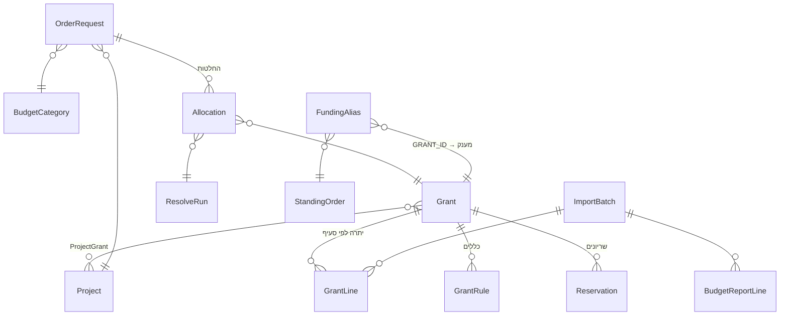

| מודל | תפקיד |
|---|---|
| `ImportBatch` | ייבוא בודד: מקור, Merge/Replace, תאריך הנתונים, מי העלה, וסטטיסטיקה |
| `Grant`, `GrantLine` | מענק מ-SAP, ויתרה לפי סעיף לכל ייבוא. הגדרות המעבדה (עדיפות, רזרבה, ימי חסימה) הן שדות של המענק |
| `GrantRule`, `Reservation` | כללי סעיף (מותר/אסור, חריגה מותרת) ושריונים |
| `BudgetCategory`, `CategoryMap` | סעיפים (שכר, חומרים, ציוד…) ומיפוי מקודי SAP וסוגי LabSuit |
| `BudgetReportLine`, `InventoryItem` | דוח "תקציב מול ביצוע" ומלאי. נשארו מגרסאות קודמות, ונגישים רק בייבוא משורת הפקודה. מחירי מלאי ישנים עוד משמשים להשלמת סכום חסר בהזמנות |
| `OrderRequest` | בקשה מ-LabSuit. המפתח הטבעי מורכב מתאריך, מבקש, פריט ומק״ט. השדות שהמעבדה ערכה (פרויקט, סעיף, סכום שהוזן ידנית) נפרדים מהשדות שמגיעים מהקובץ |
| `FundingAlias`, `StandingOrder` | מה פירוש כל ערך GRANT_ID ב-LabSuit, והזמנות עומדות |
| `Project`, `ProjectGrant`, `Person` | פרויקטים ופרויקט-על, קישור מענק-פרויקט עם העדפה, ומבקשים |
| `Allocation`, `ResolveRun` | החלטת מימון: חלק של הזמנה ממענק וסעיף, הסכום בשני המטבעות, השער, מצב (מאושר / כלול ביתרת SAP), ומתי ומי סימן "עודכן במערכות המעבדה" |
| `SourceCredential` | פרטי הכניסה ל-LabSuit של העדכון האוטומטי: רשומה אחת לשני הדשבורדים. הסיסמה מוצפנת (Fernet, עם מפתח שנגזר מ-`SECRET_KEY`) ולא נשלחת לדפדפן |
| `AutoFetchJob` | ריצה של העדכון האוטומטי: מצב, השלב הנוכחי, הודעת שגיאה, צילום מסך בכשל, והקישור לתצוגה המקדימה שנוצרה |
| `PendingImport` | קובץ שהועלה ומחכה לאישור התצוגה המקדימה. נשמר במסד ולא בדיסק, כדי לעבוד גם עם כמה workers. נמחק באישור, בביטול, או אחרי יום |
| `TrackedCurrency`, `FxRate` | מטבעות במעקב, ושער יומי (₪ ליחידה, עם 10 ספרות אחרי הנקודה) |

**סכומים** נשמרים כ-`Decimal` במטבע המקורי, ולא כ-float. ההמרה נעשית רק לתצוגה ולחישוב, והשער שבו השתמשו נשמר עם כל הקצאה.

---

## מבנה הקוד

```
labfund/
├── labfund/                  # פרויקט Django
│   ├── __init__.py           # __version__
│   ├── settings.py           # DB, middleware, RESOLVE_DEFAULTS, FX_*
│   └── urls.py               # כל הנתיבים (בלי Django admin)
├── budget/                   # האפליקציה
│   ├── models.py             # מודל הנתונים
│   ├── resolve.py            # ★ המלצה (מענק אחד לבקשה), אישור, התאמה ל-SAP, זמינות
│   ├── autofetch.py          # עדכון אוטומטי מ-LabSuit: הדפדפן האוטומטי וריצה ברקע
│   ├── fx.py                 # שערי חליפין: מקורות, רענון, חיפוש לפי תאריך
│   ├── funding.py            # סיווג תוויות GRANT_ID
│   ├── tables.py             # מנוע הטבלאות הנערכות: הגדרת עמודות, תאים, אימות
│   ├── views.py              # דשבורדים, API לעריכה ולייבוא, המלצות, הגדרות
│   ├── middleware.py         # רענון שערים בכניסה לדף
│   ├── apps.py               # יצירת admin ראשוני, תזכורת סיסמה
│   ├── context.py            # גרסה ומשתמש LabSuit השמור, לתבניות
│   ├── seed.py               # סעיפים ומיפויים התחלתיים
│   ├── importers/
│   │   ├── common.py         # קריאת קבצים, ניקוי ערכים, Merge/Replace
│   │   ├── sap_grants.py     # TRDF: יתרות לפי סעיף
│   │   ├── sap_budget.py     # תקציב מול ביצוע (שורת פקודה בלבד)
│   │   ├── labsuit_orders.py # הזמנות, והמחיר מ-LabSuit
│   │   ├── labsuit_inventory.py # מלאי (שורת פקודה בלבד)
│   │   └── preview.py        # תצוגה מקדימה: ייבוא בטרנזקציה, השוואה לפני/אחרי, ביטול
│   ├── management/commands/
│   │   ├── import_file.py    # ייבוא משורת הפקודה (‎--preview: רק להציג מה ישתנה)
│   │   ├── run_resolve.py    # המלצה ו-backtest (קריאה בלבד)
│   │   └── fetch_fx.py       # משיכה או קביעה ידנית של שער
│   ├── templates/budget/
│   │   ├── base.html         # מבנה, CSS ו-JS לעריכה במקום
│   │   ├── _table.html …     # רכיבי טבלה, תא, הוספה, ו"עדכון ממקור אחר" (קובץ / אוטומטי)
│   │   ├── orders.html, grants.html
│   │   ├── resolve.html      # מסך ההחלטה והעריכה (JS לסיכום החי)
│   │   ├── import_preview.html # תצוגה מקדימה לפני עדכון מקובץ
│   │   └── settings.html, login.html
│   ├── templatetags/money.py # עיצוב סכומים
│   ├── migrations/           # כולל seed של 14 המטבעות
│   └── tests.py              # 42 בדיקות
├── docs/screenshots/         # התמונות ב-README
├── requirements.txt
├── Dockerfile, railway.json  # פריסה: תמונת Playwright עם Chromium
└── manage.py
```

**מנוע הטבלאות** (`tables.py`): כל דשבורד מוגדר כ-`Table` עם רשימת `Col`, שקובעת מה ניתן לעריכה, מאיזה סוג ועם אילו אפשרויות. כל הטבלאות משתמשות באותה תבנית ובאותו API:

| פעולה | נתיב |
|---|---|
| שמירת תא | `POST /api/<table>/<pk>/` |
| הוספה | `POST /api/<table>/new/` |
| ייבוא (מוביל לתצוגה מקדימה) | `POST /api/<table>/import/` |
| עדכון אוטומטי מ-LabSuit | `POST /api/<table>/autofetch/`, ואז `GET /autofetch/<job>/` עד לסיום |
| מחיקה | `POST /api/<table>/<pk>/delete/` |

כך, כדי להוסיף עמודה נערכת, מספיק להוסיף `Col` אחד.

---

## התקנה והרצה

דרישות: Python 3.12 ומעלה. ה-solver (CBC) מגיע עם PuLP 3.3.2. לעדכון האוטומטי מ-LabSuit צריך גם דפדפן Chromium, שמותקן בפקודה אחת.

```bash
python -m venv .venv && source .venv/bin/activate
pip install -r requirements.txt
python -m playwright install chromium   # רק לעדכון האוטומטי מ-LabSuit
python manage.py migrate           # יוצר את הסכמה, את 14 המטבעות ואת admin / admin
python manage.py runserver         # http://127.0.0.1:8000
```

אחרי הכניסה מעלים את הקבצים דרך "עדכון מקובץ" בכל דשבורד. אפשר גם משורת הפקודה:

```bash
python manage.py import_file sap_grants        TRDF-GRANTS-CLASS-BALANCES.XLS --as-of 2026-10-12 --mode replace
python manage.py import_file labsuit_orders    orders_from_labsuit.xlsx       --as-of 2026-10-12 --mode replace
```

### משתני סביבה

| משתנה | ברירת מחדל | הערה |
|---|---|---|
| `SECRET_KEY` | מפתח פיתוח | **חובה בפרודקשן** |
| `DEBUG` | `1` | `0` בפרודקשן |
| `DATABASE_URL` | SQLite מקומי | Postgres ב-Railway |
| `ALLOWED_HOSTS` | `*` | |
| `DEFAULT_ADMIN_USERNAME` / `DEFAULT_ADMIN_PASSWORD` | `admin` / `admin` | **להגדיר לפני הפריסה הראשונה** |
| `FX_AUTO_REFRESH` | `1` | `0` מבטל משיכה אוטומטית (למשל בלי רשת) |
| `FX_REFRESH_MINUTES` | `60` | |
| `LABSUIT_ORDERS_URL` | `https://www.app.labsuit.com/dashboard/?labId=3861#orders/status[]=approved` | הדף שממנו העדכון האוטומטי מייצא הזמנות |
| `AUTOFETCH_DOWNLOAD_SECONDS` | `60` | כמה זמן לחכות לקובץ מ-LabSuit |
| `AUTOFETCH_PDFS` | `1` | `0` = לא לשמור את קובצי ה-PDF של הבקשות בעדכון האוטומטי |
| `AUTOFETCH_PDF_SECONDS` | `1500` | תקציב הזמן הכולל להורדת ה-PDF בריצה אחת |
| `AUTOFETCH_PDF_REFETCH` | `0` | `1` = להוריד מחדש גם קבצים שכבר שמורים |

### משתמש ברירת מחדל

`migrate` יוצר משתמש מנהל רק כשעוד אין אף משתמש, כך שסיסמה ששונתה לא מתאפסת. כל עוד נכנסים עם סיסמת ברירת המחדל, מוצגת באתר תזכורת לשנות אותה ב**הגדרות → משתמשים**.

---

## פריסה ל-Railway

1. Push ל-GitHub, ואז ב-Railway: **New Project → Deploy from GitHub**.
2. מוסיפים שירות **PostgreSQL**. `DATABASE_URL` מתחבר אוטומטית, ואם לא, מוסיפים אותו כ-reference variable.
3. משתני סביבה: `SECRET_KEY` (מחרוזת אקראית ארוכה), `DEBUG=0`, `DEFAULT_ADMIN_USERNAME` ו-`DEFAULT_ADMIN_PASSWORD`.
4. `railway.json` מורה ל-Railway לבנות מה-`Dockerfile`. הוא מבוסס על התמונה הרשמית של Playwright (`mcr.microsoft.com/playwright/python:v1.56.0-noble`), שכוללת את Chromium ואת ספריות המערכת שלו, כך שהעדכון האוטומטי עובד גם בשרת. ה-build מריץ `collectstatic`, וה-start מריץ `migrate` ואחריו `gunicorn`.
5. לא צריך שירות cron לשערים, כי האתר מעדכן אותם לבד.

> קובצי הנתונים של המעבדה (`*.xls`, `*.xlsx`, `data/`) מוחרגים ב-`.gitignore`. הם מכילים נתונים כספיים אמיתיים ולא אמורים להגיע לריפו.

---

## בדיקות

```bash
python manage.py test budget
```

49 בדיקות:

- פענוח הקבצים.
- המלצות: מענק אחד לבקשה, סימון "אין מקור מספיק" כשאין מענק אחד שמכסה, חריגה, אישור כפול, ואישור "הכול או כלום".
- סל המחזור: הזמנה מאושרת יוצאת מדף ההזמנות, מחזור מתמחר מחדש לפי שער היום, ו"עודכן במערכות המעבדה" מוציא אותה מהמערכת בלי להחזיר את הכסף למענק.
- התאמה ל-SAP: הזמנות שיצאו אחרי הדוח, הזמנה בלי תאריך שנשארת שמורה, כפתור "עודכן במערכות המעבדה", וזיהוי אוטומטי של GRANT_ID שנרשם ב-LabSuit.
- עדכון אוטומטי (עם דפדפן מדומה): פרטי כניסה מוצפנים ולא מוצגים, קובץ שמוביל לתצוגה מקדימה ב-Merge בלי לכתוב דבר, כשל עם הודעה וצילום מסך, וקובץ מסוג לא נכון שנעצר.
- שערי חליפין: מקורות, fallback, `unit`, ושער היסטורי בלי "עתיד". כל אלה נבדקים בלי רשת, עם mock.
- הגנה מפני ייבוא קובץ ישן.
- תצוגה מקדימה לייבוא: שום דבר לא נכתב עד האישור; ספירת חדשות, שינויים והסתרות; נתונים שנשמרים; מעבר בין Merge ל-Replace; ביטול.
- יצירת admin ראשוני.
- תצוגת ההחלטות לפי סעיף.

---

## ממצאים מהנתונים האמיתיים

- **רוב ההזמנות ב-LabSuit בלי מחיר.** רק ל-707 מתוך 5,439 הזמנות יש מחיר. בגרסאות קודמות המערכת השלימה מחיר לפי מק״ט קודם או מחיר מלאי, אבל זה הוסר: סכום הוא רק מחיר מ-LabSuit או סכום שהוזן ידנית, ובקשה בלי סכום לא מקבלת המלצה עד שמזינים אותו.
- **סטטוסים לא מתעדכנים.** כ-100 הזמנות במצב "ordered" משנים 2016–2025 לא סומנו אף פעם כ-received. לכן ההמלצות מסתכלות רק על 180 הימים האחרונים.
- **ב-12/10/2026 כמעט אין מה להחליט:**
  - 7 הזמנות פתוחות כבר נמצאות ב-SAP.
  - 3 מחויבות דרך הזמנה עומדת.
  - נשארות 2 בקשות שצריך להחליט עליהן, ולשתיהן אין מחיר. בצילומים הוזנו להן סכומים להמחשה.
- **`MATERIAL_BAL` ב-TRDF הוא 600100 ועוד 600150** (חומרים וחיות מעבדה). זה אומת מול מענק 2035816.

---

## מגבלות וצעדים הבאים

- **מפתח טבעי.** ל-LabSuit אין מזהה יציב להזמנה. אם תאריך הבקשה, המבקש או המק״ט נערכים ב-LabSuit, ההזמנה תיראה כחדשה בייבוא הבא.
- **תקרה להזמנות עומדות.** השדה קיים, אבל המערכת עוד לא אוכפת אותו.
- **שיוך לפרויקט ידני.** זה המקום הטבעי ל-OpenAI: הסקת פרויקט מההערות ("For Chen"), סיווג פריט לסעיף, ומיפוי כותרות בקבצים חדשים. תמיד כהצעה שמחכה לאישור.
- **העדכון האוטומטי נבדק מול אתר מדומה, לא מול LabSuit עצמו**, כי האתר חסום מסביבת הפיתוח. אתר הבדיקה בנוי לפי השלבים שתוארו: שדה ראשון ושני, Login, Export בצד, חלון עם Export נוסף, והורדה. בהרצה הראשונה מול LabSuit כדאי לבדוק שהשלבים זהים. אם משהו שונה, צילום המסך מהכשל יראה איפה. כדאי גם לוודא שתנאי השימוש של LabSuit מתירים גישה אוטומטית, ושאין בכניסה אימות דו-שלבי, כי רובוט לא יכול לעבור אותו.
- **הרשאות בסיסיות.** מנהל/ת מנהל/ת משתמשים, וכל משתמש מחובר יכול לערוך את שאר הנתונים. אין עדיין תפקיד צפייה בלבד.

---

## היסטוריית גרסאות

ראו [CHANGELOG.md](CHANGELOG.md).

| גרסה | עיקר השינויים |
|---|---|
| **0.7.0** | סל מחזור: הזמנות שאושרו יוצאות מדף ההזמנות ועוברות לסל בדף ההמלצות, עם נימוק ההמלצה וכפתור "מחזור" שמחזיר אותן כבקשות פתוחות ומתמחר מחדש לפי שער היום. "עודכן במערכות המעבדה" מוציא את ההזמנה מהסל ומהמערכת, והסכום נשאר מנוכה מהמענק. כל הבקשות הפתוחות בדף ההזמנות מופיעות בהמלצות, מסומנות בסיבה אם אין להן המלצה |
| **0.6.0** | המערכת מצטמצמת להזמנות ודרישות, מענקים והמלצות: דשבורדי המלאי וההוצאות מול תקציב הוסרו. Resolve נקרא עכשיו "המלצות". העדכון האוטומטי מייצא מ-`#orders/status[]=approved`, נכנס לדף פעמיים (התחברות ורענון), ותמיד עושה Merge בלי למחוק שורות, כולל שורות שנוספו ידנית |
| **0.5.0** | עדכון אוטומטי מ-LabSuit למלאי ולהזמנות, בכפתור "עדכון ממקור אחר", עם פרטי כניסה מוצפנים ותצוגה מקדימה ב-Merge. Resolve: מענק אחד לכל בקשה כברירת מחדל (תכנית בשלמים), ופיצול רק ידנית או בסימון. זיהוי אוטומטי של GRANT_ID שנרשם ב-LabSuit. הלשוניות של LabSuit ראשונות. פריסה ב-Dockerfile עם Chromium |
| **0.4.0** | תצוגה מקדימה לכל ייבוא, עם אישור או ביטול. כפתור "עודכן במערכות המעבדה" ב-Resolve. התאמה שמרנית ל-SAP: החלטה בלי תאריך ידוע נשארת שמורה. "נקלט ב-SAP" הפך ל"כלול ביתרת SAP". ייבוא מהיר פי 7, כי רק שורות שהשתנו נכתבות מחדש |
| **0.3.0** | Resolve נערך: פיצול כברירת מחדל, סיכום חי ו"רענון המלצה". האישור משפיע על כל הדשבורדים. החלטות לפי סעיף במענק. עיצוב חדש (tooltips, טבלאות צרות, נקודות סטטוס). 14 מטבעות בנק ישראל מההתחלה. השמטת שורות "סה"כ" חוצות-מטבע מ-SAP |
| **0.2.0** | דשבורדים נערכים במקום, בלי Django admin. Resolve אוטומטי לבקשות מאושרות. שערים אוטומטיים. הגדרות (שערים, פרויקטים, משתמשים). admin ראשוני |
| **0.1.0** | מודל נתונים, ייבוא LabSuit ו-SAP, ו-Resolve משורת הפקודה |

</div>
